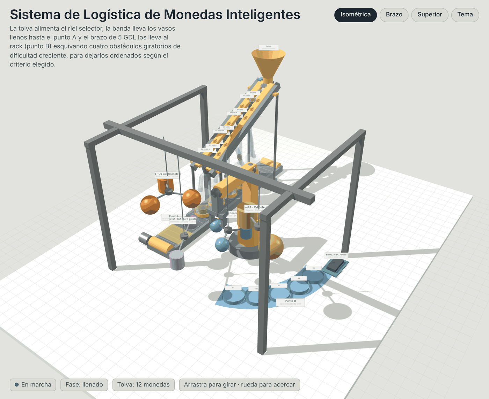
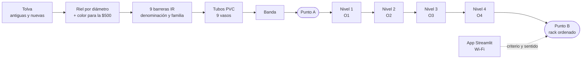
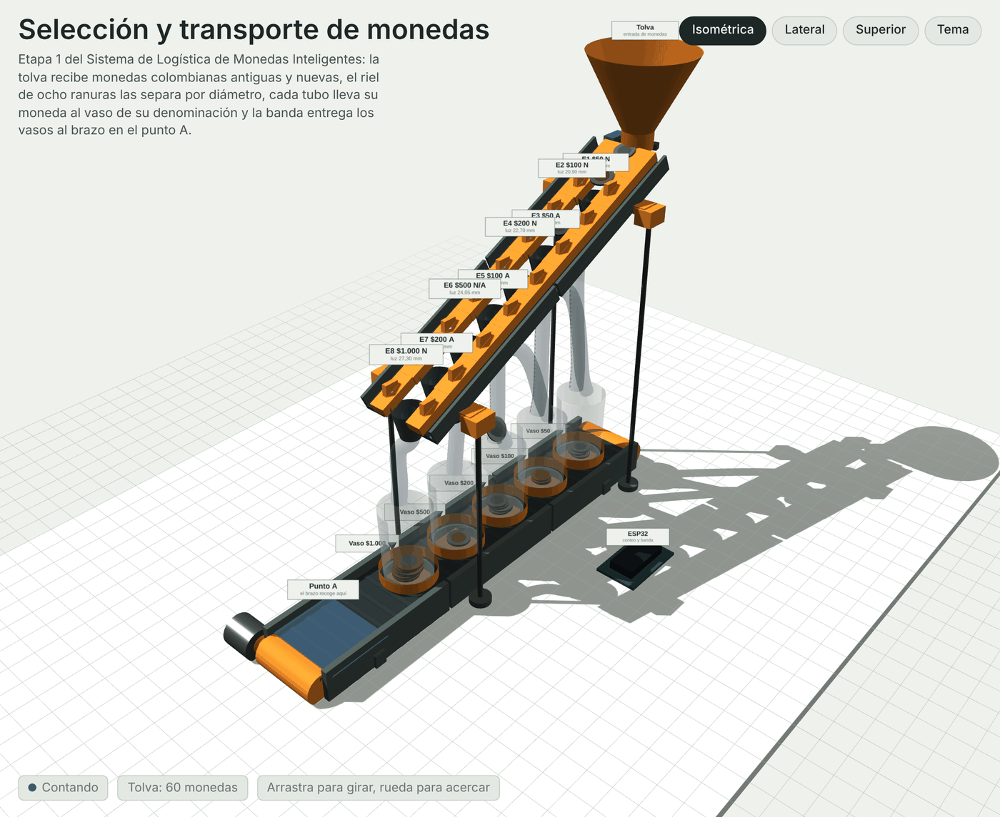
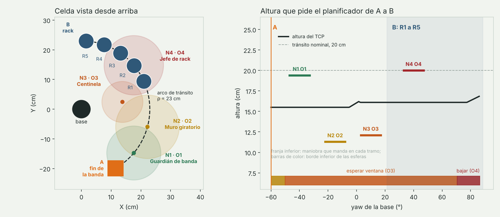
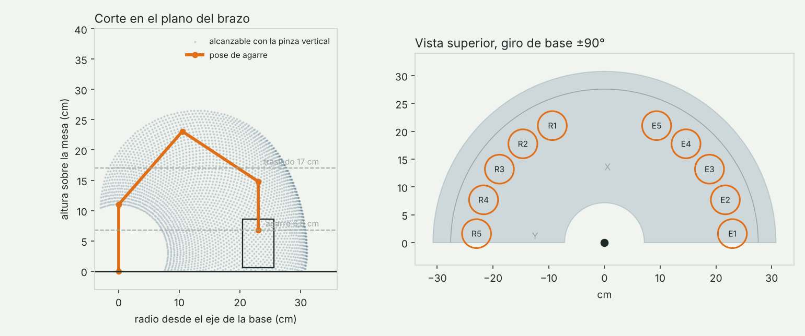
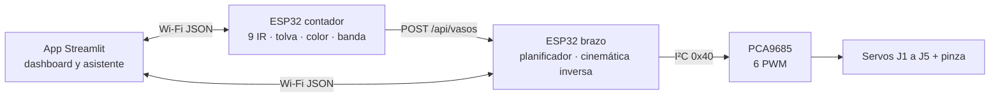

# Sistema de Logística de Monedas Inteligentes

Celda robótica que recibe monedas colombianas **antiguas y nuevas** en una tolva,
las separa por denominación, las cuenta y las embala en vasos sobre una banda.
Al final de la banda un **brazo de 5 GDL** toma cada vaso, lo lleva del **punto A
al punto B esquivando cuatro obstáculos giratorios de dificultad creciente** y
deja el rack **ordenado según la orden que recibe**: por valor, peso, cantidad,
denominación o monedas antiguas.

Proyecto de Micros y Laboratorio, Ingeniería Mecatrónica, Universidad Militar
Nueva Granada.



[](https://github.com/Johan-C777/coin-sorting-robot-pybullet/actions/workflows/pruebas.yml)


> **Entrega de avances del segundo parcial.** Qué pide el enunciado, dónde está
> cada cosa en el repositorio y qué falta: [docs/00-entrega-avances.md](docs/00-entrega-avances.md).

## Avance por etapa

| Etapa | Qué hace | Estado | Dónde |
| --- | --- | --- | --- |
| **1 · Tolva y selección** | Dosifica, separa por diámetro (7 ranuras + extremo), cuenta con 9 barreras IR y separa las dos $500 por color; un vaso por tipo de moneda | Diseño físico cerrado: 24 STL sin tornillos ni soportes, ductos y base en PVC. Sigue imprimir y armar | [visor 3D](https://johan-c777.github.io/coin-sorting-robot-pybullet/ensamble-etapa1.html), [guía de armado](docs/10-guia-armado-etapa1.md), [`hardware/etapa1-clasificador/`](hardware/etapa1-clasificador) |
| **2 · Transporte** | Banda que lleva los 9 vasos hasta el punto A | En diseño | [`hardware/etapa2-transporte/`](hardware/etapa2-transporte) |
| **3 · Brazo** | Lleva cada vaso de A a B entre cuatro obstáculos y ordena el rack | Simulado y con firmware probado en el PC; falta montar | [08-obstaculos.md](docs/08-obstaculos.md), [`hardware/etapa3-brazo/`](hardware/etapa3-brazo) |

---

## Demos en el navegador

| Demo | Qué muestra |
| --- | --- |
| [**Sistema completo**](https://johan-c777.github.io/coin-sorting-robot-pybullet/simulacion_sistema_completo.html) | Las dos etapas juntas: tolva, riel de 8 ranuras, banda, punto A, los cuatro obstáculos por nivel, punto B y el rack ordenado |
| [**Etapa 1: selección (v1)**](https://johan-c777.github.io/coin-sorting-robot-pybullet/simulacion-etapa1.html) | Primera versión del riel: monedas antiguas y nuevas, conteo por estación y vista de despiece |
| [**Ensamble etapa 1**](https://johan-c777.github.io/coin-sorting-robot-pybullet/ensamble-etapa1.html) | Las piezas que se imprimen, en posición: despiece, ficha de cada pieza y simulación de monedas cayendo a los 9 vasos |
| [**Memoria de cálculo**](https://johan-c777.github.io/coin-sorting-robot-pybullet/memoria-calculo.html) | Cinemática, espacio de trabajo, trayectorias, pares y selección de servos, con calculadoras |

Son archivos HTML autónomos (Three.js), sin instalación. También se abren desde
la carpeta [`docs/`](docs) del repositorio.

---

## Cómo funciona, de punta a punta



| Paso | Qué pasa | Dónde se ve |
| --- | --- | --- |
| 1. Selección | El riel inclinado 25° tiene 8 ranuras que se abren por escalones; cada moneda cae en la primera que supera su diámetro | [07-monedas.md](docs/07-monedas.md) |
| 2. Conteo | Una barrera IR por ranura; como cada ranura recibe un solo tipo de moneda, la estación dice denominación **y familia** | `firmware/esp32_contador` |
| 3. Embalaje | Un tubo de PVC por ducto lleva la moneda a su vaso: 9 vasos, uno por tipo de moneda | [10-guia-armado-etapa1.md](docs/10-guia-armado-etapa1.md) |
| 4. Punto A | La banda deja cada vaso en el límite del alcance del brazo | simulación |
| 5. De A a B | El brazo cruza cuatro móviles giratorios, cada uno más difícil que el anterior | [08-obstaculos.md](docs/08-obstaculos.md) |
| 6. Orden | Deja los vasos en el rack según la orden: valor, peso, cantidad, denominación o antiguas, ascendente o descendente | `software/brazo/planner.py` |

---

## Etapa 1: monedas antiguas y nuevas

En Colombia circulan dos familias de monedas: la nueva (2012) y la anterior
(1989-1996). Ordenadas por diámetro quedan ocho grupos, y el riel tiene una
ranura para cada uno:


| Estación | Moneda | Diámetro | Luz de la ranura | Masa | Vaso |
| --- | --- | --- | --- | --- | --- |
| E1 | $50 nueva | 17,00 mm | 17,60 mm | 2,00 g | $50 |
| E2 | $100 nueva | 20,30 mm | 20,90 mm | 3,34 g | $100 |
| E3 | $50 antigua | 21,50 mm | 21,95 mm | 4,50 g | $50 |
| E4 | $200 nueva | 22,40 mm | 22,70 mm | 4,61 g | $200 |
| E5 | $100 antigua | 23,00 mm | 23,35 mm | 5,31 g | $100 |
| E6 | $500, las dos familias | 23,70 mm | 24,05 mm | 7,14 g | $500 |
| E7 | $200 antigua | 24,40 mm | 25,00 mm | 7,08 g | $200 |
| E8 | $1.000 nueva | 26,70 mm | 27,30 mm | 9,95 g | $1.000 |

- **La $500 es idéntica en las dos familias** (23,70 mm y 7,14 g): comparte
  estación, y no hace falta distinguirla porque vale y pesa lo mismo.
- **La $1.000 de 1996 queda fuera**: mide 21,67 mm, a 0,17 mm de la $50 antigua.
  El diseñador del riel lo detecta solo y la rechaza; se propone un sensor de
  color para la siguiente etapa.
- **La ranura crítica es la E4**, con 0,30 mm a cada lado. Antes de imprimir el
  riel completo se imprime y se mide una probeta de las estaciones 3 a 6.
- **Las antiguas pesan más** ($200 antigua 7,08 g contra 4,61 g la nueva), así
  que el vaso guarda cuántas tiene y eso cambia el orden cuando se clasifica por
  peso.

El contador entrega el lote al brazo en una línea, donde `aN` son las antiguas:

```
VASOS:50x30a6,100x24a4,200x21a3,500x14,1000x12
```



### La etapa 1 que se imprime

El modelo de arriba fija qué monedas caben en cada ranura; la pieza física
([09-clasificador-fisico.md](docs/09-clasificador-fisico.md)) sale de
`scripts/generar_clasificador.py` y se ajustó a la impresión FDM:

- Riel de 22° en dos módulos con 7 ranuras y extremo abierto. La ranura 6 recibe
  las dos $500; un TCS34725 lee el color y el plato basculante de D6 (SG90 a
  55°/125°) manda cada una a su columna. Son **9 salidas, cada una a su vaso**.
- **Sin tornillos ni soportes:** clavijas Ø6 a presión, llaves de mariposa entre
  módulos y bridas de nailon. Las 24 piezas salen cerradas, sin choques en el
  ensamble y orientadas para imprimir sin soportes.
- **Ductos y base en PVC:** cada ducto es un adaptador impreso con la barrera IR
  más un tubo de 1" RDE 21; la base es una lámina de MDF sobre patas y tees de
  3/4" con dos bases de ABS. Deja 123 × 490 mm libres bajo la lámina para la banda.
- Impresión: 8 camas, ≈ 480 g (PLA+ negro, PETG azul y ABS) y ≈ 33 h. Las camas
  1 y 2 son de prueba de ajuste.

El contador de la versión física tiene 9 ductos; las cifras de la tabla siguen
el modelo de 8 estaciones.

---

## Etapa 3: del punto A al punto B entre cuatro obstáculos



| Nivel | Obstáculo | Qué le exige al brazo | Maniobra | Cifras |
| --- | --- | --- | --- | --- |
| **1 · Básico** | O1 Guardián de banda | Una sola variable: la altura | Paso por debajo | baja de 20 a 15,5 cm, quedan 2,1 cm libres |
| **2 · Intermedio** | O2 Muro giratorio | Mover hombro, codo y muñeca a la vez sin inclinar el vaso | Rodeo interior | recoge el TCP hasta ρ = 8,3 cm |
| **3 · Avanzado** | O3 Centinela | Predecir: no hay hueco geométrico | Espera de ventana | tapa el paso el 49 % de cada vuelta |
| **4 · Experto** | O4 Jefe de rack | Las dos cosas a la vez, encima del destino | Por debajo y bajada cronometrada | tránsito a 16,1 cm; su giro cubre R1 a R4 |

El planificador decide en cada punto del arco: primero intenta pasar por debajo,
después recogerse y rodear, y solo si nada sirve simula el cruce contra la
posición **futura** de las esferas y espera la ventana. En toda la maniobra el
cabeceo se mantiene en −90° para que el vaso no se incline.

El mismo planificador está en la simulación web y en
[`software/brazo/obstaculos.py`](software/brazo/obstaculos.py). Una prueba corre
el JavaScript de la página en Node y lo compara con Python en 147 puntos del
recorrido y 400 poses aleatorias: la diferencia máxima es de 10⁻¹⁴ cm.

---

## El brazo

Cadena antropomórfica de 5 GDL más pinza, con los tres ejes centrales
paralelos, así que la inversa es cerrada y el ESP32 la resuelve sin iterar.

| Parámetro | Valor | | Articulación | Rango | Servo |
| --- | --- | --- | --- | --- | --- |
| d₁ | 110 mm | | J1 base | −90° a 90° | MG996R + rodamiento axial |
| L₁ | 160 mm | | J2 hombro | 0° a 180° | DS3235MG |
| L₂ | 150 mm | | J3 codo | −150° a 0° | DS3218MG |
| L₃ | 80 mm | | J4 cabeceo | −120° a 60° | MG996R |
| Pinza | 0 a 70 mm | | J5 giro | −90° a 90° | MG90S |

```
directa:  ρ = L₁c₂ + L₂c₂₃ + L₃c₂₃₄     p = (c₁ρ, s₁ρ, d₁ + L₁s₂ + L₂s₂₃ + L₃s₂₃₄)
inversa:  r_w = r − L₃cos φ    h_w = h − L₃sen φ    D = (r_w² + h_w² − L₁² − L₂²)/(2L₁L₂)
          θ₃ = −arccos D    θ₂ = atan2(h_w, r_w) − atan2(L₂ sen θ₃, L₁ + L₂ cos θ₃)    θ₄ = φ − θ₂ − θ₃
```

| Resultado | Valor |
| --- | --- |
| Agarre en R1 | θ = (24,00°, 49,02°, −82,53°, −56,50°), trama `S:114,49,83,64,90,85` |
| Espacio de trabajo con pinza vertical | anillo de 7,1 a 30,8 cm |
| Singularidad | `det J = L₁L₂ sen θ₃`, solo con el brazo estirado (límite de J3) |
| Trayectorias | perfil quíntico; el giro más largo (172°) en 2,29 s con pico de 141 °/s |
| Carga de diseño | 416 g (40 monedas de $1.000); par en el hombro 13,6 kg·cm, FS 2,35 |
| PWM | PCA9685 a 50,03 Hz, 0,44° por cuenta, 1,8 mm en el TCP |

Desarrollo completo en [02-cinematica.md](docs/02-cinematica.md), la
[memoria de cálculo](docs/memoria-calculo.html) y
[03-electronica.md](docs/03-electronica.md).



---

## Arquitectura y comunicación



| Nivel | Formato | Quién habla |
| --- | --- | --- |
| Moneda | `M:100,5,antigua` | Contador → consola |
| Lote | `VASOS:50x30a6,…` o `POST /api/vasos` | Contador → brazo |
| Orden | `POST /api/ordenar {"criterio":"antiguas","sentido":"desc"}` | App → brazo |
| Estado | `GET /api/estado` cada 500 ms | Brazo → app |
| Pose | `S:j1,j2,j3,j4,j5,pinza`, 21 caracteres a 115200 baudios | PC o simulación → brazo |

La app ([`streamlit_app.py`](software/apps/streamlit_app.py)) corre en modo
simulación o contra los ESP32 por Wi-Fi; muestra valor, peso, cantidad y
antiguas, la ruta del brazo, la tabla de obstáculos y un asistente que responde
con los datos del lote. Detalle en [04-protocolo.md](docs/04-protocolo.md).

---

## Hardware

Ordenado por etapa en [`hardware/`](hardware/README.md):

- **Etapa 1:** 24 STL en [`hardware/etapa1-clasificador/stl/`](hardware/etapa1-clasificador/stl),
  lista de materiales [`bom-etapa1.csv`](hardware/etapa1-clasificador/bom-etapa1.csv)
  y [guía de armado](docs/10-guia-armado-etapa1.md) con camas, cortes de PVC,
  cableado y pruebas.
- **Etapa 2:** banda en diseño; las medidas que deja la etapa 1 están en
  [`hardware/etapa2-transporte/`](hardware/etapa2-transporte).
- **Etapa 3:** planos en SolidWorks
  ([`PLANOS BRACITO.pdf`](hardware/etapa3-brazo/PLANOS%20BRACITO.pdf)), rack,
  bandeja de electrónica y [`bom.csv`](hardware/etapa3-brazo/bom.csv).
- **Archivo:** la primera etapa 1 (riel con varillas M5) y su 3MF quedan en
  [`hardware/archivo/`](hardware/archivo/etapa1-v1) como referencia.

```bash
python scripts/generar_clasificador.py   # STL de la etapa 1
python scripts/exportar_visor_3d.py      # docs/ensamble-etapa1.html
python scripts/generar_stl.py            # rack, bandeja y piezas archivadas
python scripts/generar_figuras.py
```

---

## Validación

```bash
pytest software/tests -q              # 61 pruebas
make -C firmware/tests                # 48 comprobaciones de los dos firmwares
python scripts/verificar_alcance.py   # los dieciocho puestos y el punto A dentro del alcance
```

Hay una prueba detrás de cada número de este README: las luces del riel, el
peso con antiguas, las cifras de cada maniobra, la inversa de R1, los pares. Dos
pruebas cruzan lenguajes: una verifica que el firmware del contador usa las
mismas luces y masas que el diseño en Python, y otra que el planificador de la
página web y el de Python dan lo mismo. Las pruebas de C++ corren el firmware
completo en el PC con un `BusServos` de banco. Detalle en
[05-pruebas.md](docs/05-pruebas.md).

---

## Arranque rápido

```bash
pip install -r requirements.txt

python software/apps/cli_demo.py --criterio peso --sentido asc   # lote, ruta A→B y orden
python sim/pybullet/run_sim_integrada.py                         # las dos etapas con física
streamlit run software/apps/streamlit_app.py                     # dashboard y asistente
```

Para el hardware: copiar `secrets_example.h` como `secrets.h` en los dos
firmwares, subirlos con el IDE de Arduino (librería Adafruit PWM Servo Driver en
el brazo) y probar por monitor serie antes de conectar la potencia de 6 V:

```
VASOS:500x12,100x30a10,1000x8,50x25a9,200x17a6
ORDEN:antiguas,desc
ESTADO
```

---

## Estructura

```
docs/
├── 00-entrega-avances.md   qué pide el parcial y dónde está cada cosa
├── 01-arquitectura.md … 06-medidas-cad.md
├── 07-monedas.md           monedas antiguas y nuevas, diseño del riel
├── 08-obstaculos.md        ruta de A a B y niveles de dificultad
├── 09-clasificador-fisico.md  etapa 1 para impresión FDM
├── 10-guia-armado-etapa1.md   materiales, camas, cortes, armado, cableado y pruebas
├── archivo/                despiece de la primera etapa 1
├── index.html              portada de las demos (GitHub Pages)
└── ensamble-etapa1.html, simulacion_sistema_completo.html, simulacion-etapa1.html, memoria-calculo.html
firmware/
├── esp32_brazo/            cinemática, trayectorias, planificador, secuenciador, PCA9685, Wi-Fi
├── esp32_contador/         9 barreras IR, tolva 28BYJ-48, color de la $500, banda, Wi-Fi
└── tests/                  núcleo de los dos firmwares compilado y probado en el PC
hardware/                   por etapa: etapa1-clasificador, etapa2-transporte, etapa3-brazo, archivo
scripts/                    generadores de STL (etapa 1 y brazo), visor 3D, 3MF y figuras
sim/pybullet/               URDF, celda y orquestador integrado
software/
├── brazo/                  monedas, cinemática, obstáculos, planificador, trayectorias, protocolo
├── apps/                   cli_demo.py y streamlit_app.py
└── tests/                  60 pruebas con pytest
```

---

## Estado

- [x] Selector de monedas antiguas y nuevas: 8 estaciones calculadas, STL y firmware
- [x] Etapa 1 física: 24 STL sin tornillos ni soportes, $500 separadas por color, ductos y base en PVC, visor 3D y guía de armado
- [x] Conteo por estación y por familia, con trama hacia el brazo
- [x] Cinemática directa e inversa cerradas, verificadas contra DH y contra el URDF
- [x] Ruta de A a B con cuatro obstáculos por nivel y tres maniobras
- [x] Orden por cinco criterios en los dos sentidos
- [x] Simulación web de las dos etapas y orquestador en PyBullet
- [x] Firmware modular de los dos ESP32, con pruebas que corren en el PC
- [x] App Streamlit con modo simulación y modo Wi-Fi
- [ ] Imprimir las camas 1 y 2 de prueba, medir ranuras y ajuste, y armar la etapa 1
- [ ] Diseñar la banda transportadora (etapa 2)
- [ ] Medir L₂ y L₃ en el CAD y cerrar el perfil real del brazo
- [ ] Llevar la evasión de obstáculos al firmware del brazo
- [ ] Montar la celda, integrar los dos ESP32 con la app y medir el ciclo real

El brazo construido tiene cotas distintas de las de la simulación; el código
trae los dos perfiles (`BRAZO_PERFIL=cad`) y lo que falta medir está en
[06-medidas-cad.md](docs/06-medidas-cad.md). El historial de cambios está en
[CHANGELOG.md](CHANGELOG.md).

---

Autor: Johan Andrés Canchala Arenas ([@Johan-C777](https://github.com/Johan-C777)).
Universidad Militar Nueva Granada, Ingeniería Mecatrónica. Licencia [MIT](LICENSE).
Repositorio base del curso: [dialejobv/U_Militar](https://github.com/dialejobv/U_Militar).
