# Sistema de Logística de Monedas Inteligentes

### Módulo 1 · Clasificador de monedas colombianas (etapa 1)

[](https://github.com/Johan-C777/coin-sorting-robot-pybullet/actions/workflows/pruebas.yml)


[](https://johan-c777.github.io/coin-sorting-robot-pybullet/)


Torre de 33 cm que recibe monedas colombianas revueltas de **las dos familias**
(nueva de 2012 y anterior de 1989-1996), las sube una a una con una tolva de disco,
**mide el diámetro de cada moneda por tiempo de vuelo** con dos barreras infrarrojas,
separa las dos $500 por color y deja cada una en su vaso de un cartucho de 9. Es la
primera de las tres etapas de una celda robótica: después una banda lleva los vasos al
punto A y un brazo de 5 GDL los ordena en un rack esquivando cuatro obstáculos.

Proyecto de Micros y Laboratorio · Ingeniería Mecatrónica · Universidad Militar Nueva Granada.

<p align="center">
  <a href="https://johan-c777.github.io/coin-sorting-robot-pybullet/clasificador-v5.html">
    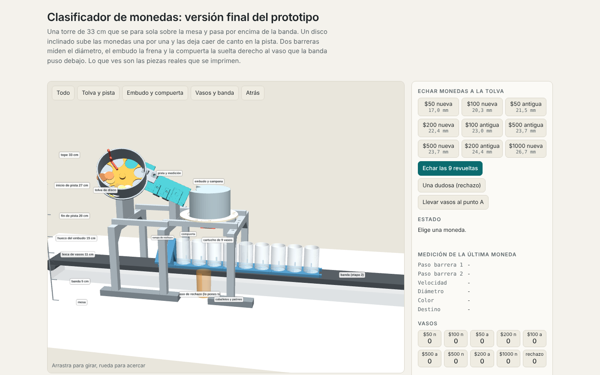
  </a>
  <br><sub>Visor 3D interactivo de la torre v5: clic en la imagen para abrirlo en el navegador.</sub>
</p>

> **Entrega de avances (Actividad 9, 31 de octubre de 2026).** El estado del módulo está
> en la sección siguiente; el detalle de qué está hecho y qué falta, casilla por casilla,
> en [**TODO.md**](TODO.md). El diseño completo de la torre está en
> [09-clasificador-v5.md](docs/09-clasificador-v5.md) y el firmware en
> [`firmware/etapa1_clasificador/`](firmware/etapa1_clasificador).

---

## Estado estratégico

**El diseño lógico, matemático y estructural del módulo está terminado y verificado
en simulación y en pruebas automáticas, y todas las piezas están impresas. El módulo
está en la fase de montaje físico.**

| Frente | Estado | Evidencia en el repositorio |
|---|---|---|
| Diseño matemático: medición, tolerancias, calibración | ✅ Completo | Modelo de cuerda con aceleración constante; error de 0,03 mm en MuJoCo; [9 pruebas](firmware/etapa1_clasificador/test/test_clasificador/test_main.cpp) |
| Diseño lógico: máquina de estados, interrupciones, protocolo | ✅ Completo | [Secuenciador](firmware/etapa1_clasificador/lib/Secuenciador) de 11 estados; [7 pruebas](firmware/etapa1_clasificador/test/test_secuenciador/test_main.cpp) con planta simulada |
| Diseño estructural: CAD paramétrico v5 | ✅ Completo | [24 STL](hardware/etapa1-clasificador/stl) generados por [`generar_v5.py`](scripts/generar_v5.py), 0 choques, 8 camas `.3mf` |
| Firmware de operación | ✅ Compila para ESP32-S3 en CI | RAM 6,5 % y flash 9,8 % ([job de CI](.github/workflows/pruebas.yml)) |
| Impresión | ✅ Completa | Las [8 camas](hardware/etapa1-clasificador/impresion/CAMAS.md) de la Creality K1C: 24 piezas en PLA+, PETG y PLA |
| Electrónica | ✅ Completa | [Pines](firmware/etapa1_clasificador/include/pines.h), [lista de conexiones](hardware/etapa1-clasificador/esquematico/conexiones.csv) y presupuesto de potencia, verificados por prueba automática |
| Montaje y pruebas físicas | ▶ Fase actual | Torre armada; [primera ronda de pruebas](docs/12-pruebas-fisicas-etapa1.md) con 13 evidencias y 6 hallazgos mecánicos en corrección (rampa trasera, disco de 6 bolsillos, compuerta doble) |
| Calibración física | ⏳ Después de las correcciones | [Procedimiento](TODO.md#fase-4--montaje-y-calibración-física) y 12 parámetros `[CAL-01]` a `[CAL-12]` marcados en el firmware |

Las cifras de desempeño de este repositorio salen de la simulación física y de pruebas
automáticas, y así se indica en cada caso. Las pruebas con la torre armada están en
[12-pruebas-fisicas-etapa1.md](docs/12-pruebas-fisicas-etapa1.md).

<p align="center">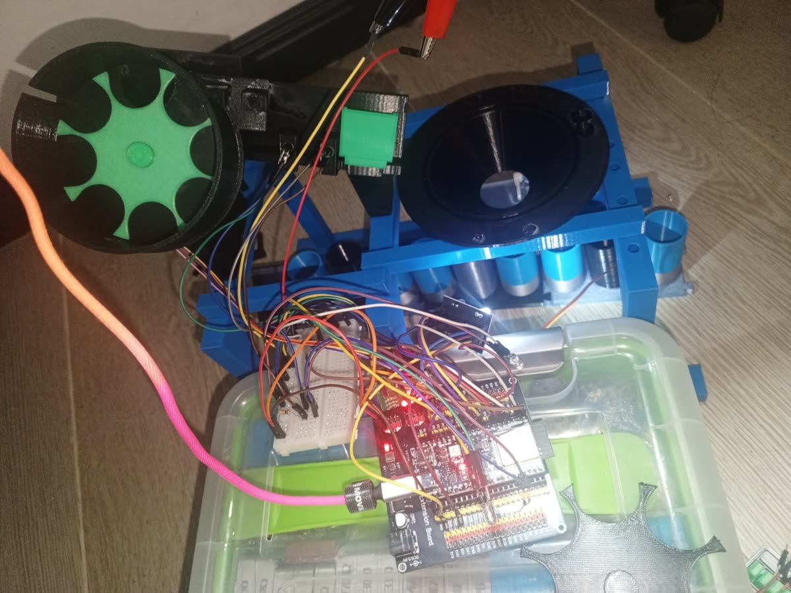<br><sub>Torre v5 armada con el ESP32-S3, primera ronda de pruebas.</sub></p> Las mediciones con monedas reales y la matriz
de confusión se registran en [05-pruebas.md](docs/05-pruebas.md) durante la calibración.

---

## Demos en el navegador (GitHub Pages)

Portada: **https://johan-c777.github.io/coin-sorting-robot-pybullet/**

| Demo | Qué muestra |
|---|---|
| [**Clasificador v5 · visor 3D**](https://johan-c777.github.io/coin-sorting-robot-pybullet/clasificador-v5.html) | La torre completa pieza por pieza: despiece, ficha de cada pieza, camino de la moneda y simulación del ciclo |
| [**Banda · etapa 2**](https://johan-c777.github.io/coin-sorting-robot-pybullet/banda-etapa2.html) | Propuesta de la banda de cadena de tablillas impresa que mueve el cartucho bajo la torre |
| [**Sistema completo**](https://johan-c777.github.io/coin-sorting-robot-pybullet/simulacion_sistema_completo.html) | Las tres etapas: tolva, banda, punto A, los cuatro obstáculos y el rack ordenado |
| [**Memoria de cálculo**](https://johan-c777.github.io/coin-sorting-robot-pybullet/memoria-calculo.html) | Cinemática, espacio de trabajo, trayectorias, pares y servos del brazo, con calculadoras |
| [Etapa 1 v1](https://johan-c777.github.io/coin-sorting-robot-pybullet/simulacion-etapa1.html) · [Ensamble v4](https://johan-c777.github.io/coin-sorting-robot-pybullet/ensamble-etapa1.html) | Versiones anteriores de la etapa 1, archivadas como historia del diseño |

Son archivos HTML autónomos (Three.js) en [`docs/`](docs); no requieren instalación.

---

## Cómo funciona el clasificador

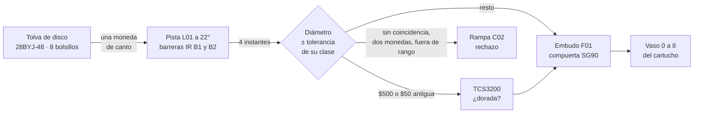

1. **Alimentación.** El disco gira un bolsillo con rampa trapezoidal. Cada bolsillo
   (Ø29) sube una moneda y la deja caer de canto a la pista; el rascador H03 tumba la
   que venga montada. Simulado en MuJoCo: 1.728 de 1.728 monedas quedan de canto.
2. **Medición.** La moneda rueda y corta dos haces IR separados 24 mm. Una interrupción
   marca el instante de cada flanco con resolución de microsegundos; con los cuatro
   instantes se resuelven velocidad, aceleración y la cuerda tapada, y de ella el diámetro.
3. **Decisión.** Vecino más cercano entre los 9 diámetros con una tolerancia propia de
   cada clase, calculada para que ninguna medida pueda caer en dos clases.
4. **Color.** Las dos $500 miden lo mismo (23,70 mm): el TCS3200 las separa por la
   razón (R+G)/2B, con un umbral que se fija con monedas reales `[CAL-05]`. El color
   también rechaza la $1.000 de 1996, que mide casi lo mismo que la $50 antigua.
5. **Entrega.** La moneda espera en la compuerta mientras la banda pone el vaso correcto
   bajo el embudo; la compuerta abre 60°, la moneda cae y el firmware la cuenta. Lo
   dudoso va a la rampa de rechazo, nunca a un vaso equivocado.

---

## Arquitectura lógica

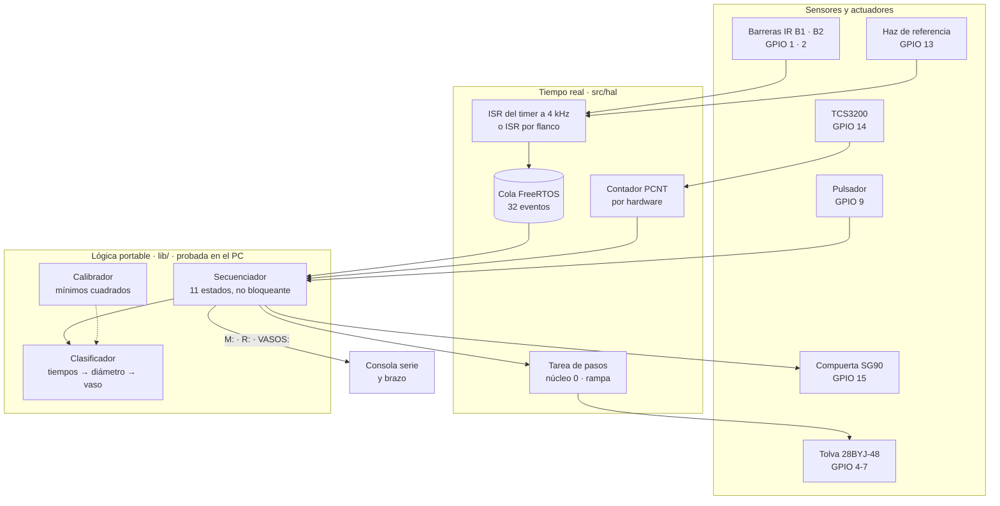

La lógica (`lib/`) no conoce el hardware: habla con una interfaz `Planta` que en la
placa implementa `src/hal/PlantaESP32` y en las pruebas una planta simulada. Por eso el
ciclo completo, con atascos, monedas dobles, vasos llenos y paro de emergencia, se
prueba en el PC sin placa.

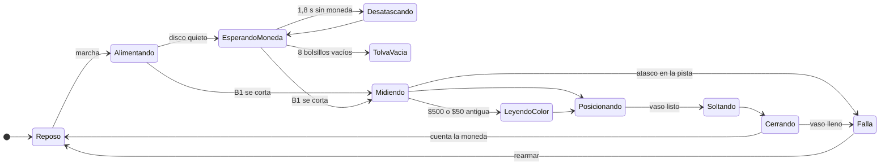

| Interrupción | Mecanismo | Por qué |
|---|---|---|
| Barreras B1, B2 (modo ADC, por defecto) | Timer por hardware a 4 kHz → ISR toma `esp_timer_get_time()` y despierta una tarea de prioridad 5 que lee el ADC con línea base adaptativa e histéresis 50 % / 70 % | Funciona con cualquier fototransistor; 250 µs entre muestras ≈ 0,12 mm a 500 mm/s |
| Barreras B1, B2 (modo digital) | ISR por flanco `CHANGE` en IRAM, lee `GPIO_IN_REG`, antirrebote de 300 µs | Resolución de 1 µs si el fototransistor satura |
| TCS3200 | Contador de pulsos PCNT | La salida llega a cientos de kHz: una ISR por pulso saturaría la CPU |
| Haz de referencia y pulsador | ISR por flanco en IRAM | Cero del cartucho; marcha, pausa y paro (2 s) |
| `loop()` | Watchdog `enableLoopWDT` | Si algo se cuelga, la placa se reinicia |

Detalle de cada capa, consola y tramas en el
[README del firmware](firmware/etapa1_clasificador/README.md).

---

## Modelo matemático de la medición

El haz cruza la pista a **h = 10 mm** sobre la repisa. Una moneda de diámetro D que
rueda de canto lo tapa a lo largo de la cuerda c:

```
c = 2·√( h·(D − h) )        ⇔        D = h + c² / (4h)
```

La moneda acelera al bajar la pista, así que no se supone velocidad constante. Con los
cuatro instantes (entra y sale de B1 y B2, separadas L = 24 mm), T = t(B2 entra) − t(B1 entra),
τ₁ y τ₂ los tiempos que cada haz queda tapado, y aceleración constante:

```
v₀·T          + ½·a·T²           = L
v₀·τ₁         + ½·a·τ₁²      − c = 0
v₀·(T + τ₂)   + ½·a·(T + τ₂)² − c = L
```

Es un sistema lineal en (v₀, a, c) que el firmware resuelve por Cramer en doble
precisión, el mismo modelo de [`sim/mujoco/rodar.py`](sim/mujoco/rodar.py). En la
simulación física el error es de **0,03 mm**, frente a 0,60 mm entre las dos monedas más
parecidas. La altura y el ancho efectivos del haz se calibran con monedas conocidas por
mínimos cuadrados ([`Calibrador`](firmware/etapa1_clasificador/lib/Clasificacion/Calibrador.cpp)).

**Tolerancia por clase** = min(0,60 mm; distancia al vecino más cercano / 2 − 0,05 mm).
Lo que no cae dentro de ninguna tolerancia, o da una velocidad o aceleración imposible,
va a rechazo con su motivo.

---

## Especificaciones mecánicas

### Monedas (Banco de la República)

| Vaso | Código | Moneda | Diámetro (mm) | Espesor (mm) | Masa (g) | Tolerancia (mm) | Se separa por |
|---|---|---|---|---|---|---|---|
| 0 | N50 | $50 nueva | 17,00 | 1,30 | 2,00 | ± 0,60 | diámetro |
| 1 | N100 | $100 nueva | 20,30 | 1,50 | 3,34 | ± 0,55 | diámetro |
| 2 | A50 | $50 antigua | 21,50 | 1,40 | 4,50 | ± 0,40 | diámetro (y color: descarta la $1.000 de 1996) |
| 3 | N200 | $200 nueva | 22,40 | 1,70 | 4,61 | ± 0,25 | diámetro |
| 4 | A100 | $100 antigua | 23,00 | 1,55 | 5,31 | ± 0,25 | diámetro |
| 5 | A500 | $500 antigua | 23,70 | 2,05 | 7,14 | ± 0,30 | diámetro + color |
| 6 | N500 | $500 nueva | 23,70 | 2,20 | 7,14 | ± 0,30 | diámetro + color |
| 7 | A200 | $200 antigua | 24,40 | 1,70 | 7,08 | ± 0,30 | diámetro |
| 8 | N1000 | $1.000 nueva | 26,70 | 2,30 | 9,95 | ± 0,60 | diámetro |
| — | — | $1.000 de 1996 | 21,67 | — | — | — | rechazo por color |

El caso crítico es la pareja $200 nueva y $100 antigua, a 0,60 mm. El catálogo del
firmware y el de Python ([`monedas.py`](software/brazo/monedas.py)) se comparan en una
prueba automática para que no se desalineen.

### Torre v5

| Subsistema | Pieza | Especificación |
|---|---|---|
| Tolva | H01, H02, H03 | Plato a 45°; disco de 8 bolsillos Ø29; 28BYJ-48 de 2.037,9 pasos por vuelta (paso completo); rascador en tres alturas: 2,5 / 2,6 / 2,8 mm |
| Pista | L01, B01 | Inclinación 22°; barreras a 105 y 129 mm (separación 24 mm); haz a 10 mm sobre la repisa; alojamientos Ø5,2 para LED y fototransistor de Ø5,0 |
| Color | A01 | TCS3200 a 152 mm sobre la pista, después de las barreras |
| Embudo | F01, F02 | Borde Ø90, pared a 45°, 60 mm adelante y 50 mm bajo el fin de la pista (simulado: 81 de 81) |
| Compuerta | G01, G02 | Paleta sobre el eje de un SG90; alojamiento de 23,1 × 12,8 mm para un cuerpo de 22,7 × 12,2; abre 60° |
| Cartucho | C01 ×3, C02, V01 ×9 | 9 vasos Ø34 × 60 mm unidos por cola de milano; rampa C02 de rechazo |
| Marco | T01, S01, S02, R01, R02 | Tres caballetes de PETG; la torre se para sobre la banda (±5 mm) |
| Uniones | P01, P02, P03 | Clavijas Ø6 y remaches impresos: **sin tornillos ni soportes de impresión** |

24 STL (22 códigos), ≈ 845 g en 8 camas para la Creality K1C (PLA+ negro, PETG azul y
PLA verde). Todo sale de un solo script paramétrico,
[`scripts/generar_v5.py`](scripts/generar_v5.py), que también comprueba que no haya
choques entre piezas. Despiece en [`despiece.csv`](hardware/etapa1-clasificador/despiece.csv),
camas en [CAMAS.md](hardware/etapa1-clasificador/impresion/CAMAS.md) y armado paso a paso
en la [guía de la etapa 1](hardware/etapa1-clasificador/README.md).

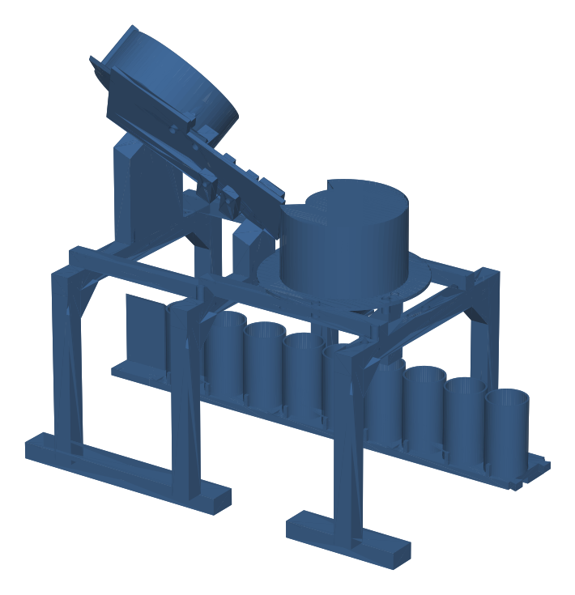

---

## Lista de materiales (BOM)

### Electrónica

| Cant. | Componente | Función | Conexión al ESP32-S3 |
|---|---|---|---|
| 1 | ESP32-S3-DevKitC-1 con shield | Control de la etapa 1 y de la banda | — |
| 1 (+1) | Motor 28BYJ-48 de 5 V con driver ULN2003 | Disco de la tolva | IN1-IN4 → GPIO 4, 5, 6, 7 |
| 1 (+1) | Micro servo SG90 (sirve MG90S) | Compuerta | Señal → GPIO 15 |
| 3 | LED IR 5 mm, 940 nm | Emisores de B1, B2 y del haz de referencia | 5 V con 330 Ω (≈ 11 mA) |
| 3 | Fototransistor 5 mm, 940 nm | Receptores | GPIO 1, 2 y 13, emisor con 10 kΩ |
| 1 | Módulo TCS3200 de 4 LED | Color de las $500 | OUT 14 · S0 18 · S1 21 · S2 16 · S3 17 |
| 3 + 3 | Resistencias de 330 Ω y 10 kΩ | Polarización de las barreras | — |
| 1 | Electrolítico de 220 µF | Picos de corriente del servo | Junto al servo |
| 1 | Fuente de 5 V, 2 A o más | Motor, servo y lógica | — |
| 1 | Pulsador (opcional) | Marcha, pausa y paro | GPIO 9 |
| — | NEMA17 + A4988 | Banda (etapa 2) | STEP 10 · DIR 11 · EN 12 |

Origen: [compras.md](hardware/etapa1-clasificador/compras.md). Diagrama, presupuesto de
potencia y lista de conexiones en [`esquematico/`](hardware/etapa1-clasificador/esquematico)
([`conexiones.csv`](hardware/etapa1-clasificador/esquematico/conexiones.csv)).

### Piezas impresas

Las 8 camas están impresas.

| Material | Camas | Piezas |
|---|---|---|
| PLA+ negro | 1, 2, 3 | Pista, tolva, disco, rascadores, soportes, embudo, rampa, clavijas |
| PETG azul | 4, 5, 6 | Caballetes y largueros del marco |
| PLA verde | 7 | 7 vasos, 2 cartuchos y la compuerta |
| Cualquiera (opcional) | 8 | Campana del embudo, solo si las monedas saltan |

---

## Firmware (PlatformIO)

```
firmware/etapa1_clasificador/
├── platformio.ini          esp32s3 (placa) y native (pruebas en el PC)
├── include/
│   ├── pines.h             mapa de pines del ESP32-S3
│   ├── config.h            muestreo, umbrales, rampas, servo, tiempos      [CAL-07..12]
│   └── calibracion.h       valores de fábrica de la medición               [CAL-01..06]
├── lib/
│   ├── Clasificacion/      Monedas.h · Clasificador · Calibrador           (C++ portable)
│   └── Secuenciador/       Planta.h (interfaz) · Secuenciador (FSM)        (C++ portable)
├── src/
│   ├── main.cpp            arranque, consola, NVS, LED de estado, watchdog
│   └── hal/                Barreras (ISR) · Color (PCNT) · Actuadores · Boton · PlantaESP32
└── test/                   16 pruebas Unity: clasificador y máquina de estados
```

```bash
cd firmware/etapa1_clasificador
pio test -e native                                   # 16 pruebas en el PC, sin placa
pio run -e esp32s3 -t upload && pio device monitor   # a la placa, consola a 115200
```

Por cada moneda el firmware imprime una línea de diagnóstico y una trama que entiende
el brazo:

```
#D n=12 v0=301 a=2448 c=21.76 D=22.42 razon=0.00 -> N200 (ok)
M:200,3,nueva
VASOS:50x3a1,100x2,200x4a1,500x2a1,1000x1
```

**Calibración física.** Cada valor que depende de la torre armada lleva una etiqueta
`[CAL-xx]` en `include/` con el procedimiento para medirlo desde la consola: separación
de los haces, altura y ancho del haz (ajuste por mínimos cuadrados con monedas conocidas,
guardado en flash), umbral de dorado, umbrales del ADC, velocidad de la tolva, ángulos de
la compuerta y tiempos. La tabla completa está en el
[README del firmware](firmware/etapa1_clasificador/README.md#calibración) y el orden de
trabajo en [TODO.md](TODO.md#fase-4--montaje-y-calibración-física).

`firmware/etapa1_prueba_motor/` es el banco de pruebas de motores y sensores con el que
se hacen las primeras mediciones; `firmware/etapa1_clasificador/` es el firmware de operación.

---

## Historia del diseño de la etapa 1

| Versión | Idea | Qué dejó |
|---|---|---|
| v1 | Riel inclinado con varillas M5 y una ranura por diámetro | Primer prototipo y las 8 estaciones por diámetro |
| v3 | Probetas del riel de canto | Primeras pruebas de la moneda rodando de canto |
| v4 | Riel de 8 ranuras con 9 ductos y base de PVC | La ranura crítica quedaba con 0,30 mm por lado y no separaba las dos $500 ni la $1.000 de 1996 |
| **v5** | **Torre de canto: diámetro por tiempo con 2 barreras IR, más color** | Versión actual: sin ranuras críticas, las 9 monedas separadas, sin tornillos |

Las versiones anteriores están en [`hardware/archivo/`](hardware/archivo) y
[`docs/archivo/`](docs/archivo).

---

## El resto del sistema: etapas 2 y 3

Las etapas 2 y 3 están diseñadas y simuladas; su montaje viene después del clasificador.

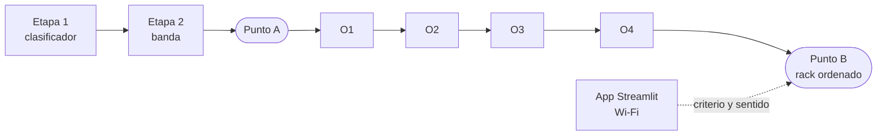

| Etapa | Qué hace | Estado | Dónde |
| --- | --- | --- | --- |
| **1 · Clasificador** | Mide, separa y cuenta las monedas en 9 vasos | Diseñado, impreso y con firmware; montaje en curso | Este README, [TODO.md](TODO.md) |
| **2 · Transporte** | Banda que pone cada vaso bajo el embudo y lo lleva al punto A | Propuesta en el [visor 3D](https://johan-c777.github.io/coin-sorting-robot-pybullet/banda-etapa2.html) | [`hardware/etapa2-transporte/`](hardware/etapa2-transporte) |
| **3 · Brazo** | Lleva cada vaso de A a B entre cuatro obstáculos y ordena el rack | Simulado y con firmware probado en el PC; falta montar | [08-obstaculos.md](docs/08-obstaculos.md), [`hardware/etapa3-brazo/`](hardware/etapa3-brazo) |

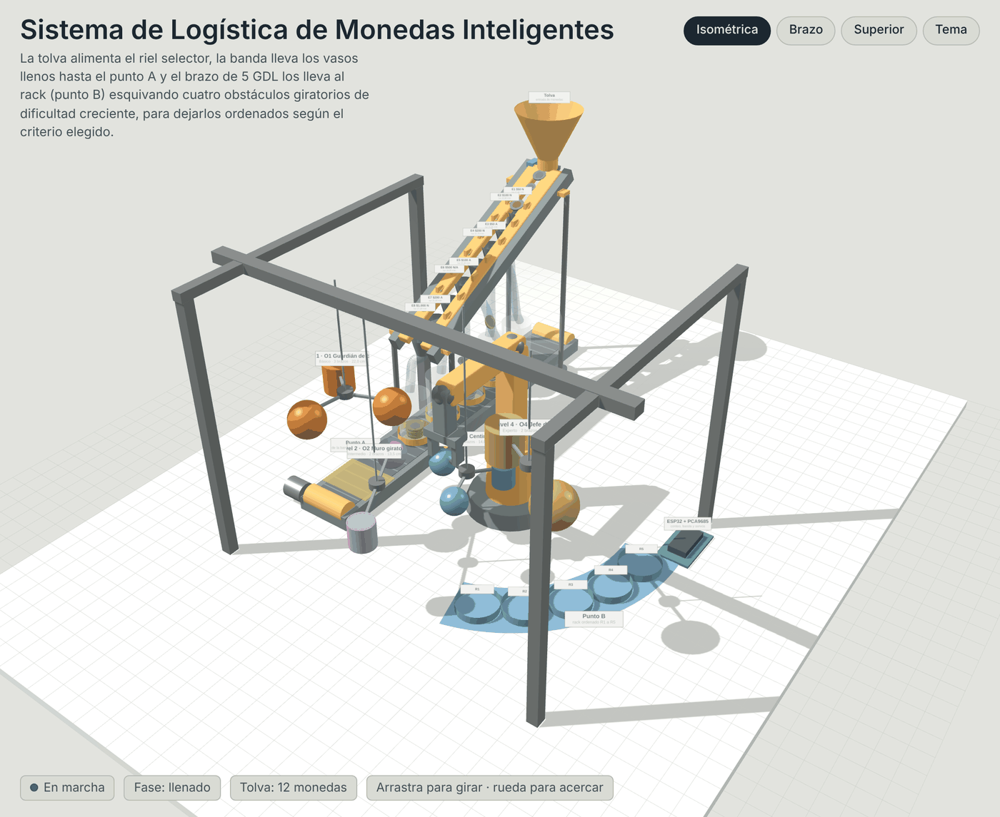

---

## Etapa 3: del punto A al punto B entre cuatro obstáculos

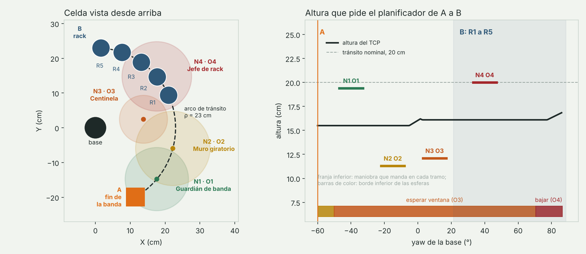

| Nivel | Obstáculo | Qué le exige al brazo | Maniobra | Cifras |
| --- | --- | --- | --- | --- |
| **1 · Básico** | O1 Guardián de banda | Una sola variable: la altura | Paso por debajo | baja de 20 a 15,5 cm, quedan 2,1 cm libres |
| **2 · Intermedio** | O2 Muro giratorio | Mover hombro, codo y muñeca a la vez sin inclinar el vaso | Rodeo interior | recoge el TCP hasta ρ = 8,3 cm |
| **3 · Avanzado** | O3 Centinela | Predecir: no hay hueco geométrico | Espera de ventana | tapa el paso el 49 % de cada vuelta |
| **4 · Experto** | O4 Jefe de rack | Las dos cosas a la vez, encima del destino | Por debajo y bajada cronometrada | tránsito a 16,1 cm; su giro cubre R1 a R4 |

El planificador decide en cada punto del arco: primero intenta pasar por debajo,
después recogerse y rodear, y solo si nada sirve simula el cruce contra la
posición **futura** de las esferas y espera la ventana. En toda la maniobra el
cabeceo se mantiene en −90° para que el vaso no se incline.

El mismo planificador está en la simulación web y en
[`software/brazo/obstaculos.py`](software/brazo/obstaculos.py). Una prueba corre
el JavaScript de la página en Node y lo compara con Python en 147 puntos del
recorrido y 400 poses aleatorias: la diferencia máxima es de 10⁻¹⁴ cm.

---

## El brazo

Cadena antropomórfica de 5 GDL más pinza, con los tres ejes centrales
paralelos, así que la inversa es cerrada y el ESP32 la resuelve sin iterar.

| Parámetro | Valor | | Articulación | Rango | Servo |
| --- | --- | --- | --- | --- | --- |
| d₁ | 110 mm | | J1 base | −90° a 90° | MG996R + rodamiento axial |
| L₁ | 160 mm | | J2 hombro | 0° a 180° | DS3235MG |
| L₂ | 150 mm | | J3 codo | −150° a 0° | DS3218MG |
| L₃ | 80 mm | | J4 cabeceo | −120° a 60° | MG996R |
| Pinza | 0 a 70 mm | | J5 giro | −90° a 90° | MG90S |

```
directa:  ρ = L₁c₂ + L₂c₂₃ + L₃c₂₃₄     p = (c₁ρ, s₁ρ, d₁ + L₁s₂ + L₂s₂₃ + L₃s₂₃₄)
inversa:  r_w = r − L₃cos φ    h_w = h − L₃sen φ    D = (r_w² + h_w² − L₁² − L₂²)/(2L₁L₂)
          θ₃ = −arccos D    θ₂ = atan2(h_w, r_w) − atan2(L₂ sen θ₃, L₁ + L₂ cos θ₃)    θ₄ = φ − θ₂ − θ₃
```

| Resultado | Valor |
| --- | --- |
| Agarre en R1 | θ = (24,00°, 49,02°, −82,53°, −56,50°), trama `S:114,49,83,64,90,85` |
| Espacio de trabajo con pinza vertical | anillo de 7,1 a 30,8 cm |
| Singularidad | `det J = L₁L₂ sen θ₃`, solo con el brazo estirado (límite de J3) |
| Trayectorias | perfil quíntico; el giro más largo (172°) en 2,29 s con pico de 141 °/s |
| Carga de diseño | 416 g (40 monedas de $1.000); par en el hombro 13,6 kg·cm, FS 2,35 |
| PWM | PCA9685 a 50,03 Hz, 0,44° por cuenta, 1,8 mm en el TCP |

Desarrollo completo en [02-cinematica.md](docs/02-cinematica.md), la
[memoria de cálculo](docs/memoria-calculo.html) y
[03-electronica.md](docs/03-electronica.md).

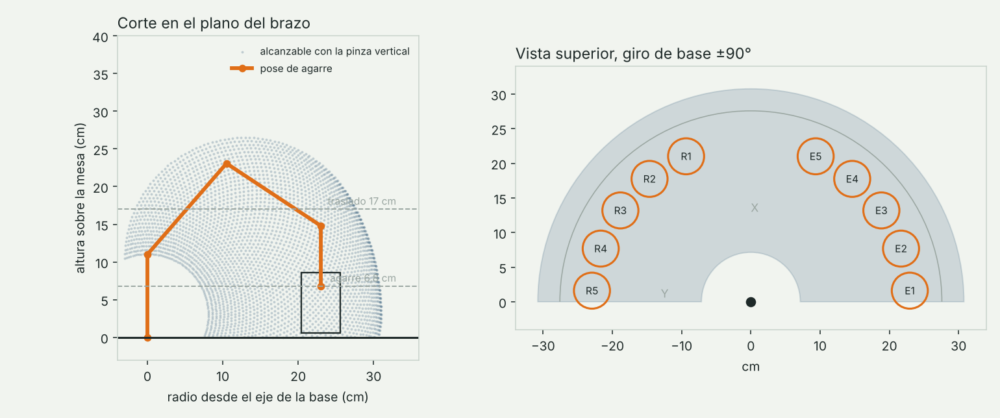

---

## Arquitectura y comunicación

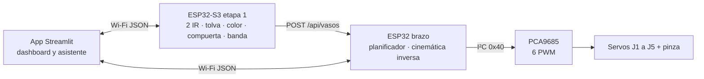

| Nivel | Formato | Quién habla |
| --- | --- | --- |
| Moneda | `M:100,5,antigua` | Contador → consola |
| Lote | `VASOS:50x30a6,…` o `POST /api/vasos` | Contador → brazo |
| Orden | `POST /api/ordenar {"criterio":"antiguas","sentido":"desc"}` | App → brazo |
| Estado | `GET /api/estado` cada 500 ms | Brazo → app |
| Pose | `S:j1,j2,j3,j4,j5,pinza`, 21 caracteres a 115200 baudios | PC o simulación → brazo |

La app ([`streamlit_app.py`](software/apps/streamlit_app.py)) corre en modo
simulación o contra los ESP32 por Wi-Fi; muestra valor, peso, cantidad y
antiguas, la ruta del brazo, la tabla de obstáculos y un asistente que responde
con los datos del lote. Detalle en [04-protocolo.md](docs/04-protocolo.md).

---

## Hardware

Ordenado por etapa en [`hardware/`](hardware/README.md):

- **Etapa 1:** 24 STL en [`hardware/etapa1-clasificador/stl/`](hardware/etapa1-clasificador/stl),
  8 camas en [`impresion/`](hardware/etapa1-clasificador/impresion),
  [`despiece.csv`](hardware/etapa1-clasificador/despiece.csv),
  [`compras.md`](hardware/etapa1-clasificador/compras.md) y el armado paso a paso en su
  [README](hardware/etapa1-clasificador/README.md); cableado en
  [`esquematico/`](hardware/etapa1-clasificador/esquematico) y
  [11-electronica-etapa1.md](docs/11-electronica-etapa1.md).
- **Etapa 2:** banda en diseño ([visor 3D de la propuesta](docs/banda-etapa2.html)); las
  medidas que deja la etapa 1 están en [`hardware/etapa2-transporte/`](hardware/etapa2-transporte).
- **Etapa 3:** planos en SolidWorks
  ([`PLANOS BRACITO.pdf`](hardware/etapa3-brazo/PLANOS%20BRACITO.pdf)), rack,
  bandeja de electrónica y [`bom.csv`](hardware/etapa3-brazo/bom.csv).
- **Archivo:** las etapas 1 anteriores (v1 con varillas M5, probetas v3 y v4 con
  riel de 8 ranuras y PVC) quedan en [`hardware/archivo/`](hardware/archivo) como referencia.

```bash
python scripts/generar_v5.py --ensamble  # STL, despiece y ensamble de la etapa 1
python scripts/armar_camas_v5.py hardware/etapa1-clasificador/stl hardware/etapa1-clasificador/impresion
python scripts/generar_stl.py            # rack, bandeja y piezas archivadas
python scripts/generar_figuras.py
```

---

## Validación

```bash
pytest software/tests -q                                   # 65 pruebas de Python
make -C firmware/tests                                     # 48 comprobaciones del contador v4 y del brazo
cd firmware/etapa1_clasificador && pio test -e native      # 16 pruebas del clasificador v5
pio run -e esp32s3                                         # compilación para la placa
python scripts/verificar_alcance.py                        # los dieciocho puestos y el punto A dentro del alcance
```

Todo corre en GitHub Actions en cada cambio ([`pruebas.yml`](.github/workflows/pruebas.yml)).
Hay una prueba detrás de cada número de este README. Varias cruzan lenguajes: el catálogo
de monedas y los pines del firmware se comparan con el diseño en Python y con el CAD
(separación y altura de las barreras), y el planificador de la página web se compara con
el de Python. Detalle en [05-pruebas.md](docs/05-pruebas.md).

---

## Arranque rápido

```bash
pip install -r requirements.txt

python software/apps/cli_demo.py --criterio peso --sentido asc   # lote, ruta A→B y orden
python sim/pybullet/run_sim_integrada.py                         # las etapas con física
streamlit run software/apps/streamlit_app.py                     # dashboard y asistente
```

Para el clasificador basta PlatformIO (ver [Firmware](#firmware-platformio)). Para el
brazo: copiar `secrets_example.h` como `secrets.h`, subirlo con el IDE de Arduino
(librería Adafruit PWM Servo Driver) y probar por monitor serie antes de conectar la
potencia de 6 V:

```
VASOS:500x12,100x30a10,1000x8,50x25a9,200x17a6
ORDEN:antiguas,desc
ESTADO
```

---

## Estructura del repositorio

```
coin-sorting-robot-pybullet/
├── README.md · TODO.md · CHANGELOG.md · ESTADO.md · LICENSE
├── .github/workflows/pruebas.yml   CI: Python, núcleo de firmwares en el PC y PlatformIO
├── docs/                           documentación técnica y sitio de GitHub Pages
│   ├── 00-entrega-avances.md       qué pide el parcial y dónde está cada cosa
│   ├── 01-arquitectura.md … 08-obstaculos.md
│   ├── 09-clasificador-v5.md       diseño de la torre de canto y su validación
│   ├── 11-electronica-etapa1.md    electrónica de la etapa 1
│   ├── index.html                  portada de las demos
│   ├── clasificador-v5.html        visor 3D de la torre v5
│   ├── banda-etapa2.html           visor 3D de la banda propuesta
│   ├── memoria-calculo.html, simulacion_sistema_completo.html, …
│   ├── img/                        figuras y capturas
│   └── archivo/                    documentos de las versiones anteriores
├── firmware/
│   ├── etapa1_clasificador/        firmware de operación del clasificador (PlatformIO)
│   ├── etapa1_prueba_motor/        banco de pruebas de motores y sensores (PlatformIO)
│   ├── esp32_brazo/                cinemática, trayectorias, planificador, PCA9685, Wi-Fi
│   ├── esp32_contador/             contador de la etapa 1 v4
│   └── tests/                      núcleo de los firmwares del brazo y contador en el PC
├── hardware/
│   ├── etapa1-clasificador/        stl/ (24) · impresion/ (8 camas) · esquematico/ · despiece · compras · guía
│   ├── etapa2-transporte/          medidas de interfaz para la banda
│   ├── etapa3-brazo/               planos, rack, bandeja y BOM del brazo
│   └── archivo/                    etapa 1 v1, v3 y v4
├── scripts/                        generadores paramétricos de STL, camas, 3MF y figuras
├── sim/
│   ├── mujoco/                     disco, pista de canto, embudo y compuerta de la etapa 1
│   └── pybullet/                   URDF, celda y orquestador integrado
└── software/
    ├── brazo/                      monedas, cinemática, obstáculos, planificador, protocolo
    ├── apps/                       cli_demo.py y streamlit_app.py
    └── tests/                      65 pruebas con pytest
```

---

## Estado del sistema completo

- [x] Etapa 1: diseño de la medición, CAD v5, simulación, electrónica y firmware de operación
- [x] Etapa 1: todas las piezas impresas (8 camas, 24 piezas)
- [x] Etapa 1: torre armada y primera ronda de pruebas mecánicas ([registro](docs/12-pruebas-fisicas-etapa1.md))
- [ ] Etapa 1: correcciones H1 a H6, calibración `[CAL-01..12]` y prueba de 100 monedas ([TODO.md](TODO.md))
- [x] Etapa 2: propuesta de banda en visor 3D
- [ ] Etapa 2: diseño de detalle e integración con el cartucho
- [x] Etapa 3: cinemática directa e inversa cerradas, verificadas contra DH y contra el URDF
- [x] Etapa 3: ruta de A a B con cuatro obstáculos por nivel y orden por cinco criterios
- [x] Simulación web de las etapas, orquestador en PyBullet y app Streamlit
- [ ] Etapa 3: medir L₂ y L₃ en el CAD y llevar la evasión de obstáculos al firmware
- [ ] Montar la celda, integrar los dos ESP32 con la app y medir el ciclo real

El brazo construido tiene cotas distintas de las de la simulación; el código trae los
dos perfiles (`BRAZO_PERFIL=cad`) y lo que falta medir está en
[06-medidas-cad.md](docs/06-medidas-cad.md). Historial de cambios en
[CHANGELOG.md](CHANGELOG.md).

---

Autor: Johan Andrés Canchala Arenas ([@Johan-C777](https://github.com/Johan-C777)).
Universidad Militar Nueva Granada, Ingeniería Mecatrónica. Licencia [MIT](LICENSE).
Repositorio base del curso: [dialejobv/U_Militar](https://github.com/dialejobv/U_Militar).
