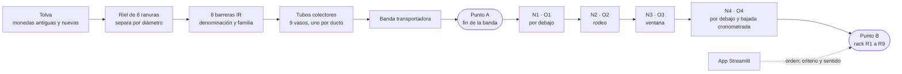
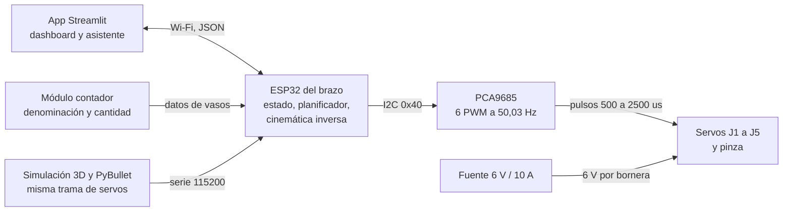
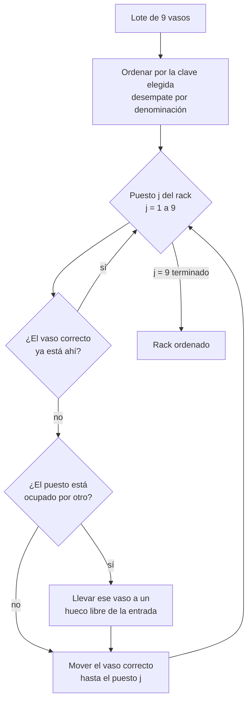

# Arquitectura del sistema

La celda tiene dos etapas. La primera recibe monedas colombianas antiguas y
nuevas, las separa, las cuenta y las embala en nueve vasos (uno por ducto) sobre una banda. La
segunda es el brazo: toma cada vaso en el punto A, lo lleva al punto B
esquivando cuatro obstáculos y deja el rack ordenado según la orden de la app.

## Requisitos

| Código | Requisito | Dónde se verifica |
| --- | --- | --- |
| RF0 | Separar monedas de la familia nueva (2012) y de la anterior, contarlas por denominación y por familia | `software/tests/test_monedas.py`, `firmware/tests/test_conteo.cpp` |
| RF1 | Recoger vasos en el punto A y depositarlos en los nueve puestos del rack (punto B) | `software/tests/test_trajectory.py`, `firmware/tests` |
| RF1b | Llegar de A a B esquivando cuatro obstáculos de dificultad creciente | `software/tests/test_obstaculos.py`, [08-obstaculos.md](08-obstaculos.md) |
| RF2 | Ordenar por denominación, cantidad, valor, peso o cantidad de antiguas, en ambos sentidos | `software/tests/test_planner.py`, `test_monedas.py` |
| RF3 | Recibir órdenes y datos de vasos (con sus antiguas) desde la app y el contador | `docs/04-protocolo.md` |
| RF4 | Reportar pose, estado y contenido del rack | `brazo/protocol.py::estado_json` |
| RF5 | Modo manual articular y cartesiano para calibrar | simulación 3D y comando `S:` |
| RNF1 | Mínimo 4 GDL | 5 GDL más pinza |
| RNF2 | Carga útil de 416 g (vaso con 40 monedas de $1.000) | `software/tests/test_statics.py` |
| RNF3 | Tolerancia de ±5 mm en los puestos | resolución de 1,8 mm, holgura de pinza de 7 mm |
| RNF4 | Ciclo menor a 10 s por vaso a velocidad 1× | 7,1 s medidos en `cli_demo` |
| RNF5 | Potencia de servos separada de la lógica, con tierra común | `docs/03-electronica.md` |
| RNF6 | Piezas imprimibles en 3D y componentes de bajo costo | `hardware/etapa3-brazo/bom.csv`, `hardware/etapa1-clasificador/despiece.csv`, `hardware/etapa1-clasificador/compras.md` |

## Bloques del brazo

## Responsabilidades

| Bloque | Qué hace | Qué no hace |
| --- | --- | --- |
| App Streamlit | Elige criterio y sentido, muestra ruta, valor, peso y cantidad | No calcula cinemática |
| ESP32 | Guarda el estado de los dieciocho puestos, planifica, resuelve la inversa y comanda | No decide el criterio |
| PCA9685 | Genera los seis PWM por hardware | No conoce la geometría |
| Simulación | Reemplaza al hardware mientras se construye | No sustituye la calibración real |

## La celda

Dieciocho puestos sobre un arco de radio 23 cm: entrada E1 a E9 entre −88° y −12°,
rack R1 a R9 entre 12° y 88°, separados 9,5°. La cuerda entre puestos vecinos es
3,81 cm y el vaso (el de la etapa 1, Ø34 mm) mide 3,4 cm, así que quedan solo
4 mm libres: la pinza cerrada (31 mm) baja sobre el vaso y se abre a 66 mm, pero
el margen de colocación es de ±2 mm. Como todos comparten
radio, la postura del brazo es la misma en los dieciocho y solo cambia θ₁: eso
simplifica el plan y hace que el error de posicionamiento sea parejo.

## Algoritmo de orden

Desde la entrada son exactamente nueve movimientos. Reordenando un rack ya lleno
son como máximo dieciocho, porque cada vez que se saca un vaso del rack se libera un
hueco de entrada.
