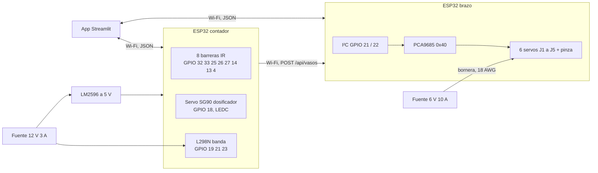

# Electrónica y potencia

Dos ESP32: uno para la etapa 1 (conteo, dosificador y banda) y otro para el
brazo. Hablan entre sí y con la app por Wi-Fi.



## ESP32 del contador

| Elemento | Pines | Nota |
| --- | --- | --- |
| Barreras IR, estaciones E1 a E8 | 32, 33, 25, 26, 27, 14, 13, 4 | Una por ranura, interrupción en flanco de bajada, antirrebote de 25 ms |
| Servo SG90 de la paleta | 18 | PWM por LEDC, canal 0 |
| Puente H L298N de la banda | 19 (IN1), 21 (IN2), 23 (ENA) | PWM por LEDC, canal 1 |

Se evitan los pines de arranque del ESP32 (0, 2, 5, 12 y 15): el GPIO 12 en alto
al encender cambia la tensión de la flash y el módulo no arranca. También se
evitan los 34 a 39, que son solo de entrada y no tienen resistencia de pull-up.

## ESP32 del brazo

## Por qué un PCA9685

El ESP32 no genera los PWM: los delega en un PCA9685 por I²C. Así el Wi-Fi no
mete jitter en la señal de los servos y quedan diez canales libres para crecer.

```
prescale = round(25 MHz / (4096 × 50 Hz)) − 1 = 121
f_real   = 25 MHz / (4096 × 122) = 50,03 Hz
tick     = 1 / (4096 × 50,03) = 4,88 us
```

Cada grado de servo son 11,11 µs, o sea 2,28 cuentas, y la resolución es de
0,44° por cuenta: 1,8 mm en el TCP a 23 cm del eje, dentro de la tolerancia de
±5 mm. La banda muerta del servo (3 µs, 0,27°) es el eslabón débil, no el
controlador. Conviene calibrar el oscilador real con `setOscillatorFrequency()`
porque entre unidades varía entre 23 y 27 MHz.

Conversión que usan el firmware y la simulación:

```
t_on = 500 us + (s / 180°) × 2000 us
```

## Presupuesto de corriente

| Canal | Servo | Masa | Corriente de bloqueo a 6 V |
| --- | --- | --- | --- |
| 0, J1 | MG996R | 55 g | 2,5 A |
| 1, J2 | DS3235MG | 60 g | ≈3,5 A |
| 2, J3 | DS3218MG | 60 g | 1,8 a 2,6 A |
| 3, J4 | MG996R | 55 g | 2,5 A |
| 4, J5 | MG90S | 13,4 g | ≈0,8 A |
| 5, pinza | MG90S | 13,4 g | ≈0,8 A |
| | | **Suma peor caso** | **12,7 A** |

Que los seis se bloqueen a la vez es una falla, no una condición de trabajo: en
el arranque simultáneo de un tramo el consumo real ronda la mitad. Se dimensiona
una fuente de **6 V y 10 A** con un condensador de 2.200 µF junto a la bornera.
Los valores de bloqueo son de catálogo, conviene confirmarlos con el proveedor.

## Conexiones

| Desde | Hasta | Nota |
| --- | --- | --- |
| ESP32 3V3 | PCA9685 VCC | solo lógica |
| ESP32 GPIO21 | PCA9685 SDA | I²C a 400 kHz |
| ESP32 GPIO22 | PCA9685 SCL | dirección 0x40 |
| ESP32 GND | bornera de tierra | tierra común obligatoria |
| Fuente 6 V (+) | bornera de potencia y V+ del PCA9685 | cable 18 AWG |
| Bornera | cable rojo de los seis servos | distribución en estrella |
| PCA9685 canales 0 a 5 | señal de J1 a J5 y pinza | 22 AWG |
| PCA9685 OE | GND | salidas habilitadas |
| Fuente 12 V con reductor a 5 V | ESP32 VIN | en banco se alimenta por USB |

La potencia va por bornera propia, no por las pistas de la placa del PCA9685,
que no están hechas para esa corriente.

## Detalle del prototipo real

La simulación comanda el cierre de pinza a 40 mm y el vaso la detiene en 52 mm.
Un servo real seguiría empujando y quedaría en bloqueo permanente. Por eso el
firmware comanda 49 mm: 3 mm de interferencia que absorben las almohadillas de
TPU (`PINZA_CERRADA_MM` en `config.h` y en `config.py`).

## Lista de materiales

En [`hardware/bom.csv`](../hardware/bom.csv), con el detalle de materiales y su
justificación en [`hardware/materiales.md`](../hardware/materiales.md).
