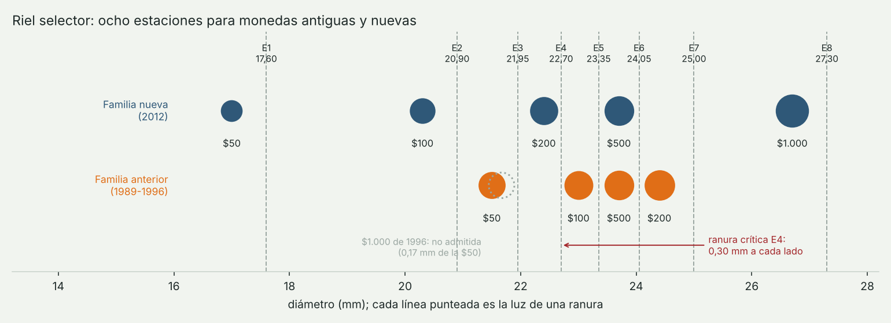

# Monedas antiguas y nuevas: diseño del selector

La tolva recibe monedas colombianas de las dos familias que siguen circulando:
la **nueva**, que el Banco de la República emite desde el segundo semestre de
2012, y la **anterior**, emitida entre 1989 y 1996. El riel las separa por
diámetro sin motores ni sensores de decisión, y cada estación cuenta con su
barrera infrarroja.



## Catálogo

Diámetros y masas de las fichas técnicas del Banco de la República. Están en
código en [`software/brazo/monedas.py`](../software/brazo/monedas.py), de donde
los toman el diseño del riel, los STL, el firmware y las pruebas.

| Moneda | Familia | Desde | Diámetro | Masa | Material |
| --- | --- | --- | --- | --- | --- |
| $50 | nueva | 2012 | 17,00 mm | 2,00 g | acero niquelado |
| $100 | nueva | 2012 | 20,30 mm | 3,34 g | acero recubierto de latón |
| $200 | nueva | 2012 | 22,40 mm | 4,61 g | acero niquelado |
| $500 | nueva | 2012 | 23,70 mm | 7,14 g | bimetálica |
| $1.000 | nueva | 2012 | 26,70 mm | 9,95 g | bimetálica |
| $50 | anterior | 1989 | 21,50 mm | 4,50 g | alpaca (Cu-Zn-Ni) |
| $100 | anterior | 1992 | 23,00 mm | 5,31 g | Cu-Al-Ni, dorada |
| $200 | anterior | 1994 | 24,40 mm | 7,08 g | alpaca (Cu-Zn-Ni) |
| $500 | anterior | 1993 | 23,70 mm | 7,14 g | bimetálica |
| $1.000 | anterior | 1996 | 21,67 mm | 7,30 g | Cu-Al-Ni |

Dos datos mandan sobre todo el diseño:

1. **La $500 es igual en las dos familias**: 23,70 mm y 7,14 g. El riel no puede
   separarlas, y tampoco hace falta: valen y pesan lo mismo. Comparten estación
   y se cuentan juntas.
2. **La $1.000 de 1996 mide 21,67 mm**, a 0,17 mm de la $50 antigua (21,50 mm).
   Ninguna ranura impresa separa esa diferencia, y es además una moneda escasa
   en circulación. Queda fuera de alcance en esta etapa; la salida propuesta es
   un sensor de color en la estación 3, porque la $50 es plateada y la $1.000
   de 1996 dorada. El diseñador la rechaza de forma explícita:
   `disenar_selector(CATALOGO)` lanza un error con las dos monedas en conflicto.

## Las ocho estaciones

Ordenadas por diámetro, las monedas admitidas forman ocho grupos. La luz de cada
ranura se calcula con

```
luz_i = d_i + min(0,6 mm ; (d_(i+1) − d_i) / 2)      redondeada a 0,05 mm
```

| Estación | Moneda | Diámetro | Luz | Cae con | Margen contra la siguiente | Vaso |
| --- | --- | --- | --- | --- | --- | --- |
| E1 | $50 nueva | 17,00 | 17,60 | 0,60 | 2,70 | $50 |
| E2 | $100 nueva | 20,30 | 20,90 | 0,60 | 0,60 | $100 |
| E3 | $50 antigua | 21,50 | 21,95 | 0,45 | 0,45 | $50 |
| E4 | $200 nueva | 22,40 | 22,70 | **0,30** | **0,30** | $200 |
| E5 | $100 antigua | 23,00 | 23,35 | 0,35 | 0,35 | $100 |
| E6 | $500 (las dos) | 23,70 | 24,05 | 0,35 | 0,35 | $500 |
| E7 | $200 antigua | 24,40 | 25,00 | 0,60 | 1,70 | $200 |
| E8 | $1.000 nueva | 26,70 | 27,30 | 0,60 | — | $1.000 |

Medidas en mm. Para reproducir la tabla:

```bash
cd software && python -m brazo.monedas
```

Como cada estación recibe una sola combinación de denominación y familia, la
barrera de la estación ya dice qué moneda pasó. No hace falta pesar ni mirar la
moneda para saber si es antigua.

## Del riel a los vasos

Las estaciones de la misma denominación no quedan juntas (la $50 nueva cae en la
1 y la antigua en la 3), así que cada embudo tiene una espiga para un tubo
flexible de 3/4" que lleva la moneda al vaso de su denominación. Quedan **nueve
vasos**, uno por ducto (las $500 antiguas y nuevas separadas por el color), que es lo que recibe el brazo en el punto A. Los
tubos de las antiguas van por detrás del riel y los de las nuevas por delante.

El vaso guarda cuántas de sus monedas son antiguas porque pesan distinto: una
$200 antigua pesa 7,08 g y una nueva 4,61 g. Eso cambia el peso del vaso, y por
tanto el orden cuando se clasifica por peso:

| Lote de ejemplo | Sin distinguir familias | Contando las antiguas |
| --- | --- | --- |
| $100 x 30 (10 antiguas) | 118,2 g | 137,9 g |
| $50 x 25 (9 antiguas) | 68,0 g | 90,5 g |
| $200 x 17 (6 antiguas) | 96,4 g | 111,2 g |
| Orden por peso ascendente | $50, $200, $1.000, $500, $100 | $50, $1.000, $500, $200, $100 |

La prueba `test_las_antiguas_cambian_el_orden_por_peso` comprueba justo eso, y
su gemela en C++ (`orden por peso con monedas antiguas`) lo comprueba en el
firmware del brazo.

La carga de diseño del brazo no cambia: el vaso más pesado posible sigue siendo
el de 40 monedas de $1.000 nuevas, 416 g. Es un valor de diseño con margen: en un vaso de Ø34 × 60 mm caben físicamente unas 26 monedas de $1.000 (≈ 280 g).

## Tramas

El contador le entrega el lote al brazo en una línea; `aN` dice cuántas monedas
del vaso son antiguas y se omite cuando no hay:

```
VASOS:50x30a6,100x24a4,200x21a3,500x14,1000x12
```

Una línea sin `a` sigue siendo válida, así que el formato anterior no se rompe.
Cada moneda contada sale además por el serie con su estación y su familia:

```
M:100,5,antigua
```

## Riesgos y siguiente paso

- La ranura 4 tiene 0,30 mm a cada lado. Antes de imprimir el riel completo hay
  que imprimir una probeta de las estaciones 3 a 6 y medirla (ver
  [despiece de la v1](archivo/despiece-etapa1-v1.md#tolerancias-y-calibración)). Si no alcanza la
  precisión, ese tramo se corta en acrílico.
- La $1.000 de 1996 necesita un sensor de color para entrar al sistema.
- El desgaste de las monedas antiguas reduce su diámetro unas décimas; conviene
  medir una muestra real del lote antes de fijar las luces.

## Fuentes

- Banco de la República, [Monedas en circulación](https://www.banrep.gov.co/es/billetes-y-monedas/monedas).
- Fichas de [$100 (1992)](https://www.banrep.gov.co/es/billetes-monedas/moneda-100-pesos),
  [$100 nueva](https://www.banrep.gov.co/es/billetes-monedas/moneda-100-nueva),
  [$200 (1994)](https://banrep.gov.co/es/billetes-monedas/moneda-200-pesos),
  [$500 (1993)](https://banrep.gov.co/es/billetes-monedas/moneda-500-pesos),
  [$500 nueva](https://www.banrep.gov.co/es/billetes-monedas/moneda-500-nueva),
  [$1.000 (1996)](https://banrep.gov.co/es/billetes-monedas/moneda-1000-pesos) y
  [$50](https://banrep.gov.co/es/billetes-monedas/moneda-50-pesos).
- Diámetro de la $50 anterior: [Numista N# 1073](https://en.numista.com/1073).
