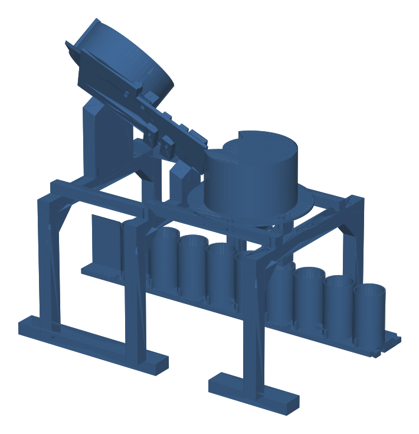

# Etapa 1 v5: clasificador de canto

Versión vigente de la etapa 1. Reemplaza el riel de 8 ranuras con ductos de PVC
(v4, [archivado](archivo/09-clasificador-fisico-v4.md)). Piezas, camas, despiece
y armado en [`hardware/etapa1-clasificador/`](../hardware/etapa1-clasificador/README.md);
electrónica en [11-electronica-etapa1.md](11-electronica-etapa1.md).



## Qué cambió frente a la v4 y por qué

| v4 (riel de ranuras) | v5 (torre de canto) | Motivo |
|---|---|---|
| Una ranura por diámetro, 9 barreras IR, 9 ductos de PVC a 9 vasos fijos | Una sola pista con 2 barreras IR que miden el diámetro por tiempo, un embudo y una compuerta | Menos piezas y sensores; la ranura crítica de la v4 tenía 0,30 mm por lado |
| Base de MDF y PVC de 560 × 198 mm | Torre de 33 cm sobre 3 caballetes impresos, de pie sobre la banda | Todo impreso, sin cortes de PVC ni herrajes |
| Vasos quietos bajo los ductos | Cartucho de 9 vasos que la banda (etapa 2) pone bajo el embudo | La misma banda lleva después los vasos al punto A del brazo |
| Plato basculante para las dos $500 | TCS34725 en la pista; la compuerta solo suelta cuando el vaso correcto está debajo | El color decide el vaso, no un desvío mecánico |

## Recorrido de una moneda

1. **Tolva de disco (H01, H02, H03).** Plato a 45°; el 28BYJ-48 gira un disco de 8
   bolsillos Ø29. El rascador H03 tumba la moneda que venga montada sobre otra.
2. **Caída de canto.** Arriba, el bolsillo pasa sobre un hueco y la moneda cae unos
   2 cm a la pista, parada contra la placa.
3. **Pista (L01, B01).** 22° de pendiente, placa a 20° de la vertical. Barreras IR a
   105 y 129 mm (24 mm entre haces): el tiempo de paso da la cuerda y de ahí el
   diámetro. El TCS34725 a 152 mm separa la $500 antigua (dorada) de la nueva.
4. **Embudo (F01, F02).** Borde Ø90 con pared a 45°, 60 mm adelante y 50 mm bajo el
   fin de la pista.
5. **Compuerta (G01, G02).** Paleta sobre el eje del SG90: sostiene la moneda y abre
   60° cuando la banda ya puso el vaso correcto debajo.
6. **Cartucho (C01 × 3, C02, V01 × 9).** Orden de los vasos: $50 n, $100 n, $50 a,
   $200 n, $100 a, $500 a, $500 n, $200 a, $1.000 n. Lo dudoso va a la rampa C02 y
   cae a un vaso de rechazo en la mesa.

## Validación

| Qué | Cómo | Resultado |
|---|---|---|
| La moneda sale del disco y queda de canto | `sim/mujoco/disco.py` | 1.728 de 1.728 casos |
| La moneda entra al embudo | `sim/mujoco/embudo.py` | 81 de 81 casos |
| Medir diámetro por tiempo entre dos barreras | `sim/mujoco/rodar.py` | error simulado ≈ 0,03 mm (las monedas vecinas difieren 0,6 mm) |
| Piezas cerradas, sin choques y dentro de la cama de la K1C | `scripts/generar_v5.py --ensamble` | 24 STL, 0 choques, ≈ 845 g |
| Impresión | camas 1 a 6 impresas (oct. 2026) | falta la cama 7 (vasos, cartucho y compuerta) |

No validado todavía con piezas reales: que el disco tome siempre una sola moneda,
la compuerta, el posicionamiento del cartucho (depende de la banda) y el ruido
real de los sensores. Meta del prototipo: 90 % bien clasificadas y el resto a
rechazo.

## Regenerar

```bash
pip install manifold3d numpy
python scripts/generar_v5.py --ensamble          # STL, despiece.csv y ensamble
python scripts/armar_camas_v5.py hardware/etapa1-clasificador/stl hardware/etapa1-clasificador/impresion
pip install mujoco && python sim/mujoco/disco.py  # simulaciones de respaldo
```
