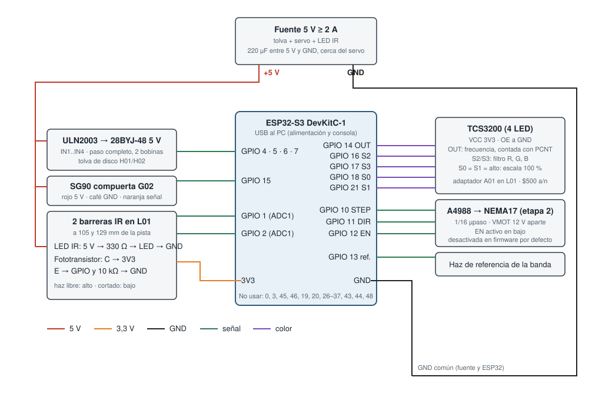

# Electrónica de la etapa 1 (ESP32-S3)

Un ESP32-S3 DevKitC-1 con su shield controla la tolva, la compuerta, las dos
barreras IR y el sensor de color de la torre v5 ([09-clasificador-v5.md](09-clasificador-v5.md)),
y deja reservados los pines de la banda (etapa 2). El firmware está en
[`firmware/etapa1_prueba_motor/`](../firmware/etapa1_prueba_motor) (PlatformIO).

> Esta etapa reemplaza al "ESP32 contador" clásico de [03-electronica.md](03-electronica.md)
> (9 barreras IR de la v4). El ESP32 del brazo no cambia.



## Pines

| Función | GPIO | Conexión |
|---|---|---|
| 28BYJ-48 por ULN2003, IN1..IN4 | 4, 5, 6, 7 | ULN2003 y motor a 5 V externos, GND común |
| SG90 compuerta (señal) | 15 | Servo a 5 V externos |
| Fototransistor barrera 1 (105 mm) | 1 (ADC1_CH0) | C → 3V3; E → GPIO y 10 kΩ → GND |
| Fototransistor barrera 2 (129 mm) | 2 (ADC1_CH1) | igual que la barrera 1 |
| LED IR de las barreras | — | 5 V → 330 Ω → LED → GND (≈ 11 mA), siempre encendidos |
| TCS3200 OUT | 14 | salida en frecuencia, contada con el PCNT |
| TCS3200 S2 / S3 | 16 / 17 | filtro: R (0,0), G (1,1), B (0,1) |
| TCS3200 S0 / S1 | 18 / 21 | ambos en alto = escala 100 % (o directo a 3V3); OE a GND, VCC 3V3 |
| A4988 STEP / DIR / EN (banda, etapa 2) | 10 / 11 / 12 | EN activo en bajo; VMOT 12 V aparte |
| Haz de referencia de la banda | 13 | mismo circuito que las barreras |
| Libres | 8, 9, 38–42, 47 | |

Pines que no se usan en el S3: 0, 3, 45, 46 (strapping), 19 y 20 (USB), 26–37
(flash y PSRAM octal), 43 y 44 (UART0) y 48 (LED RGB de la placa).

## Alimentación

| Rama | Fuente | Consumo aprox. |
|---|---|---|
| ESP32-S3 + TCS3200 + fototransistores | USB del PC (3V3 de la placa) | < 250 mA |
| 28BYJ-48 por ULN2003 (paso completo, 2 bobinas) | 5 V externos | ≈ 240 mA |
| SG90 | 5 V externos, 220 µF cerca del servo | 150 mA, picos de 650 mA |
| 2 LED IR | 5 V externos | 22 mA |
| NEMA17 (etapa 2) | 12 V por el A4988 | ajustar Vref del A4988 |

Fuente de 5 V de al menos 2 A. El GND de la fuente va unido al GND del ESP32.

## Barreras IR: cómo se mide el diámetro

Cada fototransistor está en seguidor de emisor: con el haz libre la tensión en el
GPIO es alta; cuando la moneda corta el haz, baja. El firmware toma una base al
arrancar y considera el haz cortado por debajo del 50 % de esa base y libre por
encima del 70 % (histéresis). Con la velocidad que da el paso entre las dos
barreras (24 mm entre haces) y el tiempo que una de ellas queda cortada, calcula
la cuerda y la compara con los diámetros de las 9 monedas (tolerancia 0,6 mm);
lo que no encaja va al vaso de rechazo. La $500 antigua y la nueva miden lo
mismo (23,7 mm) y las separa el TCS3200 por la relación (R+G)/2B: el firmware
cuenta los pulsos de cada filtro durante 4 ms con el contador de pulsos (PCNT)
del S3 y se queda con la lectura más brillante (moneda centrada frente al sensor).

## Tolva: por qué paso completo

El 28BYJ-48 no arrancaba bien. El firmware lo mueve en **paso
completo con dos bobinas** (más par), con rampa de aceleración desde 180 pasos/s
hasta 800 pasos/s, energiza las bobinas 15 ms antes del primer paso y usa la
reducción real de 63,684:1 (2.037,9 pasos por vuelta) para que el disco de 8
bolsillos no se desfase. La velocidad se ajusta desde la consola serie (`v`, `k`, `s`)
y `t` hace un barrido de 400 a 1.400 pasos/s para ver dónde empieza a perder pasos.

## Firmware

```bash
cd firmware/etapa1_prueba_motor
pio run -t upload && pio device monitor     # consola: '?' para la ayuda
```

| Tecla | Acción |
|---|---|
| `a` | ciclo automático on/off |
| `d` | un ciclo (un bolsillo, medir, compuerta) |
| `f` / `b` | avanzar / retroceder un bolsillo |
| `o` / `p` | abrir / cerrar la compuerta |
| `v`, `k`, `s` + número | velocidad máxima, aceleración y velocidad de arranque de la tolva |
| `t` | barrido de velocidad de la tolva |
| `m` | monitor de las barreras y del color cada 200 ms |
| `r` | resumen de monedas por vaso |

Los parámetros (pines, velocidades, ángulos del servo, umbrales y diámetros) están
en `src/config.h`. Compila con `platform = espressif32` 7.x (Arduino-ESP32 3.x) y 6.x. La banda está desactivada (`HABILITAR_BANDA 0`) hasta que se
monte la etapa 2.

## Pendiente

- Probar el motor con la tolva cargada y fijar la velocidad máxima real.
- Calibrar `K_CUERDA` y `UMBRAL_DORADO` con monedas reales (líneas `MONEDA … c1 c2 razon` de la consola y monitor `m`).
- Montar el TCS3200 en L01 con el adaptador A01 (se corta el rebaje del TCS34725 y se pega con cianoacrilato).
- Confirmar el modelo exacto del shield y que no use ninguno de los pines de arriba.
- Esquemático en KiCad (el diagrama de arriba es de bloques).
