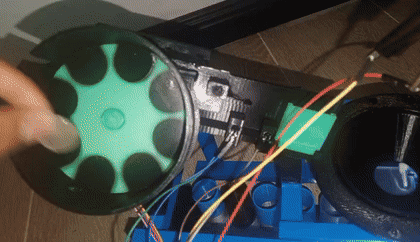
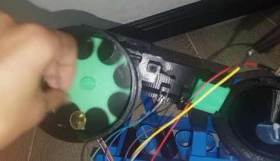
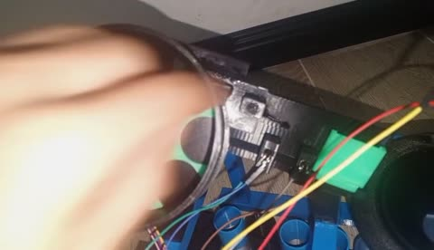
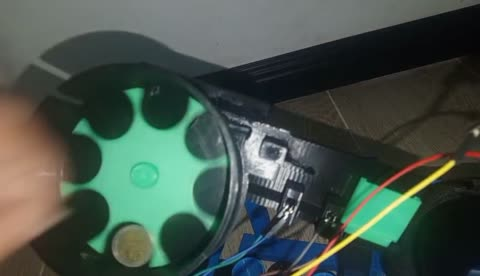
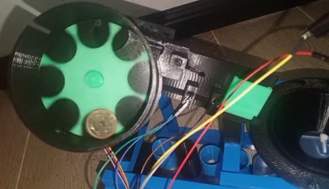
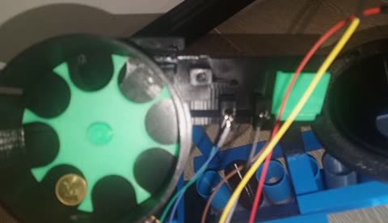
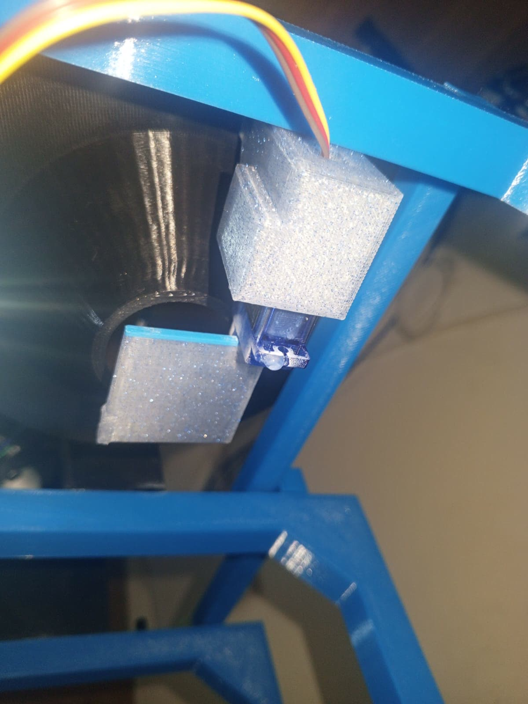
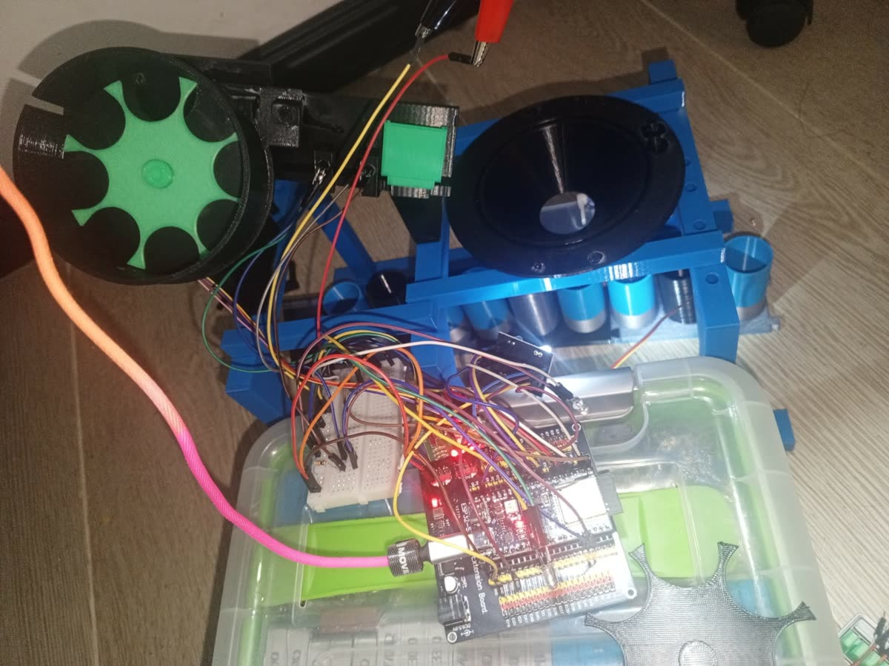

# Pruebas físicas de la etapa 1 (torre v5)

Pruebas con la torre armada y monedas reales de las 7 denominaciones, registradas el 3 de
noviembre de 2026. Se evaluó la parte mecánica: la tolva de disco, la caída a la pista L01, la
compuerta y el cartucho. Cada observación se convirtió en un ajuste de diseño (H1 a H6), y los
ajustes están impresos y montados en la torre.

Los videos se reproducen desde GitHub Pages; las miniaturas llevan al video.

## Resumen

| Prueba | Subsistema | Resultado | Observación |
|---|---|---|---|
| [$50 antigua](#prueba-50-antigua) | Tolva → L01 | 🔧 Salía por atrás → tope H04 | H1 |
| [$100 antigua](#prueba-100-antigua) | Tolva → L01 | ✅ Sigue la pista | — |
| [$100 nueva](#prueba-100-nueva) | Tolva → L01 | 🔧 Salía por atrás → tope H04 | H1 |
| [$200 nueva](#prueba-200-nueva) | Tolva → L01 | 🔧 Bolsillo justo → disco H02e | H1, H2 |
| [$200 antigua](#prueba-200-antigua) | Tolva → L01 | 🔧 Bolsillo justo → disco H02e | H1, H2 |
| [$500 nueva](#prueba-500-nueva) | Tolva → L01 | 🔧 Bolsillo justo → disco H02e | H1, H2 |
| [$500 antigua](#prueba-500-antigua) | Tolva → L01 | ✅ Sigue la pista | — |
| [$1.000](#prueba-1000) | Disco de la tolva | 🔧 Bolsillo Ø29 pequeño → Ø40 en H02e | H2 |
| [Fricción del disco](#fricción-del-disco) | Disco y portadisco | 🔧 Fricción → disco nuevo, lijado y lubricado | H3 |
| [Compuerta](#compuerta) | Compuerta G01/G02 | 🔧 Huecos en la paleta → paleta plana G03 | H4 |
| [Vasos](#cartucho-y-vasos) | Cartucho C01/C02 + 9 vasos | ✅ Ensamble sin problemas | — |
| [Montaje general](#montaje-general) | Torre completa y cableado | ✅ Armada · 🔧 cableado con jumpers largos | H6 |
| Tolva llena | Tolva con todas las monedas | 🔧 Carga recomendada por tanda y vaivén de desatasco | H5 |

✅ = funcionó con la geometría original · 🔧 = dio lugar a un ajuste de diseño, ya aplicado.

Las pruebas cumplieron su objetivo: ajustar la geometría con monedas reales. Cada observación es
mecánica y dio lugar a una pieza nueva o a un cambio de parámetros.

## Observaciones y ajustes

| # | Observación | Causa | Ajuste | Estado |
|---|---|---|---|---|
| H1 | La moneda que sale del disco cae por la parte de atrás en vez de seguir a L01 | Queda un hueco detrás del punto de caída | Tope trasero H04 que redirige la moneda al riel L01 | ✅ Impreso y montado |
| H2 | Las monedas grandes ($200, $500 nueva) quedan justas en el bolsillo y se atascan; la $1.000 (26,70 mm) no entra | Bolsillos Ø29 con 8 bolsillos en el disco: no queda holgura para las monedas grandes | Disco de **5 bolsillos Ø40** (H02e; el H02c de 6×Ø33 tampoco admitió la $1.000). Pasos por bolsillo en el firmware: 2.037,9 / 5 | ✅ Disco H02e (`stl/ajustes/`) impreso y firmware a 5 bolsillos |
| H3 | El disco se traba varias veces | Fricción entre el disco y el portadisco sin alisar; par bajo del 28BYJ-48 | Lijar el portadisco y la cara trasera del disco; lubricante seco (grafito o PTFE); nervios de apoyo en la cara trasera del disco; holgura axial de 0,3 a 0,5 mm; bajar `TOLVA_VMAX` y `TOLVA_ACC` `[CAL-09]`; fuente de 5 V firme para el motor | ✅ Disco nuevo; lijado y lubricado |
| H4 | A veces la moneda que baja de L01 se desliza por los huecos de la paleta antes de que la compuerta abra | Huecos entre la paleta G02 y el embudo | Paleta plana G03 pegada sobre G02 | ✅ Impresa y montada |
| H5 | Con la tolva llena, las monedas que caen de canto (verticales) se quedan abajo "bailando" sin acostarse | La pestaña que las tumba (rascador H03) está muy arriba y las monedas verticales no llegan a ella | Bolsillos Ø40 de H02e, que dejan acostarse a la moneda; vaivén del disco cuando no sale moneda (`reintentos_desatasco` en el firmware); operación por tandas de monedas en lugar de la tolva llena. Para una siguiente versión: nervios bajos en el plato de la tolva | ✅ Aplicado en disco y firmware |
| H6 | Los jumpers del primer montaje no alcanzaban desde la placa hasta las barreras IR y el TCS3200 | Jumpers cortos | Jumpers más largos; fijar la protoboard y el ESP32 al marco y agrupar los cables por sensor | ✅ Recableado |

## Evidencia

### Prueba $50 antigua

Observación H1: la moneda salía por el hueco de atrás, que ahora cierra el tope H04.

[Ver video](https://johan-c777.github.io/coin-sorting-robot-pybullet/pruebas/etapa1/video/prueba_50_antigua.mp4)

### Prueba $100 antigua

Funciona: la moneda sigue la trayectoria hacia L01.

[Ver video](https://johan-c777.github.io/coin-sorting-robot-pybullet/pruebas/etapa1/video/prueba_100_antigua.mp4)

### Prueba $100 nueva

Observación H1, igual que la $50 antigua.

### Prueba $200 nueva

Observaciones H1 y H2: salía por atrás y quedaba justa en el bolsillo del disco original.

### Prueba $200 antigua

Observaciones H1 y H2: la moneda más gruesa (1,7 mm) quedaba justa en el bolsillo del disco original.

### Prueba $500 nueva

Observaciones H1 y H2, igual que la $200 nueva.

### Prueba $500 antigua

Funciona: fluye y cae bien a la pista, igual que la $100 antigua.

### Prueba $1000

Observación H2: la $1.000 (26,70 mm) no cabía en el bolsillo Ø29 del disco original.

### Fricción del disco

Observación H3: el disco original se frenaba por fricción con el portadisco.

### Compuerta

Observación H4: la moneda pasaba por los huecos de la paleta G02; la paleta plana G03 los cierra.

[Ver video](https://johan-c777.github.io/coin-sorting-robot-pybullet/pruebas/etapa1/video/error_puerta.mp4)

### Cartucho y vasos

Funciona: tres módulos C01 unidos por cola de milano, la rampa de rechazo C02 y los 9 vasos.

### Montaje general

Torre armada sobre el marco: tolva (en la foto, con el disco original de 8 bolsillos), pista L01
con las barreras, adaptador del TCS3200, embudo y cartucho; ESP32-S3 en su placa de extensión con
protoboard. Observación H6: el cableado se rehízo con jumpers largos agrupados por sensor.

## Ajustes aplicados

1. Disco H02e de 5 bolsillos Ø40 (H2, H3), tope trasero H04 (H1) y paleta plana G03 sobre la
   compuerta (H4), impresos y montados; portadisco lijado y lubricado (H3).
2. Firmware de operación y de banco a 5 bolsillos por vuelta (2.037,9 / 5 pasos por bolsillo).
3. Cableado de las barreras IR y del TCS3200 con jumpers largos (H6).
4. La calibración fina de barreras, color y compuerta sigue el procedimiento `[CAL-xx]` de la
   [fase 4 de TODO.md](../TODO.md#fase-4--montaje-y-pruebas-físicas).
