# Pruebas físicas de la etapa 1 (torre v5)

Primera ronda de pruebas con la torre armada y monedas reales, registrada el 3 de noviembre de 2026.
Se probó la parte mecánica: la tolva de disco, la caída a la pista L01, la compuerta y
el cartucho. Las barreras IR y el TCS3200 todavía no se probaron, porque los jumpers no
alcanzan desde la placa hasta los sensores (hallazgo H6).

Los videos se reproducen desde GitHub Pages; las miniaturas llevan al video.

## Resumen

| Prueba | Subsistema | Resultado | Hallazgo |
|---|---|---|---|
| [$50 antigua](#prueba-50-antigua) | Tolva → L01 | ❌ Cae por atrás | H1 |
| [$100 antigua](#prueba-100-antigua) | Tolva → L01 | ✅ Sigue la pista | — |
| [$100 nueva](#prueba-100-nueva) | Tolva → L01 | ❌ Cae por atrás | H1 |
| [$200 nueva](#prueba-200-nueva) | Tolva → L01 | ❌ Cae por atrás y se atasca a veces | H1, H2 |
| [$200 antigua](#prueba-200-antigua) | Tolva → L01 | ❌ Cae por atrás y se atasca seguido | H1, H2 |
| [$500 nueva](#prueba-500-nueva) | Tolva → L01 | ❌ Cae por atrás y se atasca a veces | H1, H2 |
| [$500 antigua](#prueba-500-antigua) | Tolva → L01 | ✅ Sigue la pista | — |
| [$1.000](#prueba-1000) | Disco de la tolva | ❌ No entra al bolsillo | H2 |
| [Atascos](#atascos-del-disco) | Disco y portadisco | ❌ El disco se traba | H3 |
| [Compuerta](#compuerta) | Compuerta G01/G02 | ❌ La moneda se cuela a veces | H4 |
| [Vasos](#cartucho-y-vasos) | Cartucho C01/C02 + 9 vasos | ✅ Ensamble sin problemas | — |
| [Montaje general](#montaje-general) | Torre completa y cableado | ✅ Armada · ❌ jumpers cortos | H6 |
| Tolva llena | Tolva con todas las monedas | ❌ Monedas verticales no se reacomodan (sin video) | H5 |

De las 7 denominaciones que se pasaron por la tolva, 2 llegan bien a la pista. Todos los
fallos son mecánicos y tienen una corrección definida, salvo H5, que sigue abierto.

## Hallazgos y correcciones

| # | Hallazgo | Causa | Corrección | Estado |
|---|---|---|---|---|
| H1 | La moneda que sale del disco cae por la parte de atrás en vez de seguir a L01 | Queda un hueco detrás del punto de caída | Rampa trasera que redirija la moneda al riel L01 | Por diseñar e imprimir |
| H2 | Las monedas grandes ($200, $500 nueva) quedan justas en el bolsillo y se atascan; la $1.000 (26,70 mm) no entra | Bolsillos Ø29 con 8 bolsillos en el disco: no queda holgura para las monedas grandes | Disco de **5 bolsillos Ø40** (H02e; el H02c de 6×Ø33 tampoco admitió la $1.000). Pasos por bolsillo en el firmware: 2.037,9 / 5 | Disco H02e diseñado (`stl/ajustes/`) y firmware a 5 bolsillos; por imprimir y probar |
| H3 | El disco se traba varias veces | Fricción entre el disco y el portadisco sin alisar; par bajo del 28BYJ-48 | Lijar el portadisco y la cara trasera del disco; lubricante seco (grafito o PTFE); nervios de apoyo en la cara trasera del disco; holgura axial de 0,3 a 0,5 mm; bajar `TOLVA_VMAX` y `TOLVA_ACC` `[CAL-09]`; fuente de 5 V firme para el motor | Lijado por hacer; nervios con el disco nuevo |
| H4 | A veces la moneda que baja de L01 se desliza por los huecos de la paleta antes de que la compuerta abra | Huecos entre la paleta G02 y el embudo | Segunda paleta igual, pegada encima de la actual | Por imprimir |
| H5 | Con la tolva llena, las monedas que caen de canto (verticales) se quedan abajo "bailando" sin acostarse | La pestaña que las tumba (rascador H03) está muy arriba y las monedas verticales no llegan a ella | Abierto. Propuestas: una pestaña o nervios bajos en el plato de la tolva que tumben la moneda vertical; más vaivén del disco al detectar que no sale moneda (`reintentos_desatasco` en el firmware); cargar menos monedas a la vez; los bolsillos más grandes de H2 también ayudan a que se acuesten | Abierto |
| H6 | Los jumpers no alcanzan desde la placa hasta los sensores; no se pudieron probar las barreras IR ni el TCS3200 | Jumpers cortos | Jumpers más largos; fijar la protoboard y el ESP32 al marco y agrupar los cables por sensor | Por comprar |

## Evidencia

### Prueba $50 antigua

Hallazgo H1: la moneda cae por el hueco de atrás.

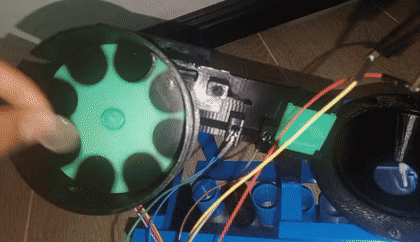

[Ver video](https://johan-c777.github.io/coin-sorting-robot-pybullet/pruebas/etapa1/video/prueba_50_antigua.mp4)

### Prueba $100 antigua

Funciona: la moneda sigue la trayectoria hacia L01.

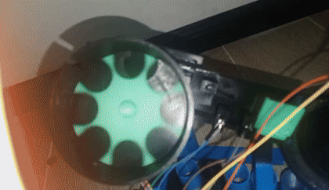

[Ver video](https://johan-c777.github.io/coin-sorting-robot-pybullet/pruebas/etapa1/video/prueba_100_antigua.mp4)

### Prueba $100 nueva

Hallazgo H1, igual que la $50 antigua.

[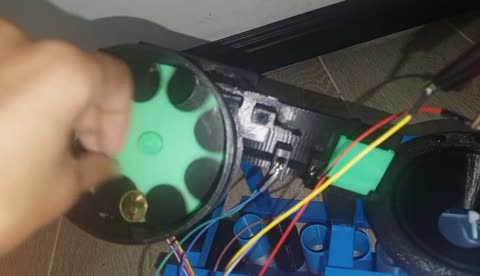](https://johan-c777.github.io/coin-sorting-robot-pybullet/pruebas/etapa1/video/prueba_100_nueva.mp4)

### Prueba $200 nueva

Hallazgos H1 y H2: cae por atrás y a veces se atasca porque queda justa en el bolsillo.

[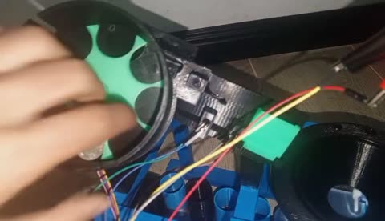](https://johan-c777.github.io/coin-sorting-robot-pybullet/pruebas/etapa1/video/prueba_200_nueva.mp4)

### Prueba $200 antigua

Hallazgos H1 y H2, con atascos más frecuentes: hay que girar el disco a mano.

[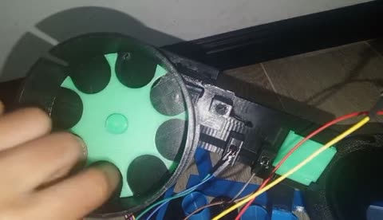](https://johan-c777.github.io/coin-sorting-robot-pybullet/pruebas/etapa1/video/prueba_200_antigua.mp4)

### Prueba $500 nueva

Hallazgos H1 y H2, igual que la $200 nueva.

[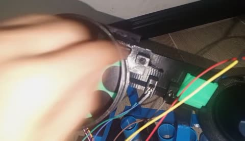](https://johan-c777.github.io/coin-sorting-robot-pybullet/pruebas/etapa1/video/prueba_500_nueva.mp4)

### Prueba $500 antigua

Funciona: fluye y cae bien a la pista, igual que la $100 antigua.

[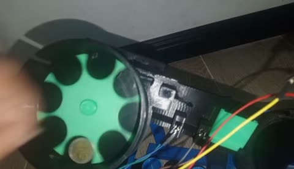](https://johan-c777.github.io/coin-sorting-robot-pybullet/pruebas/etapa1/video/prueba_500_antigua.mp4)

### Prueba $1000

Hallazgo H2: la $1.000 no entra al bolsillo y el disco no la mueve.

[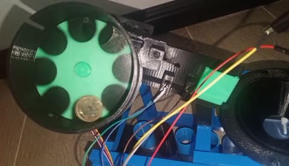](https://johan-c777.github.io/coin-sorting-robot-pybullet/pruebas/etapa1/video/prueba_1000.mp4)

### Atascos del disco

Hallazgo H3: el disco se traba por fricción con el portadisco.

[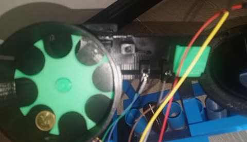](https://johan-c777.github.io/coin-sorting-robot-pybullet/pruebas/etapa1/video/atascos.mp4)

### Compuerta

Hallazgo H4: la moneda se cuela por los huecos de la paleta antes de que abra.

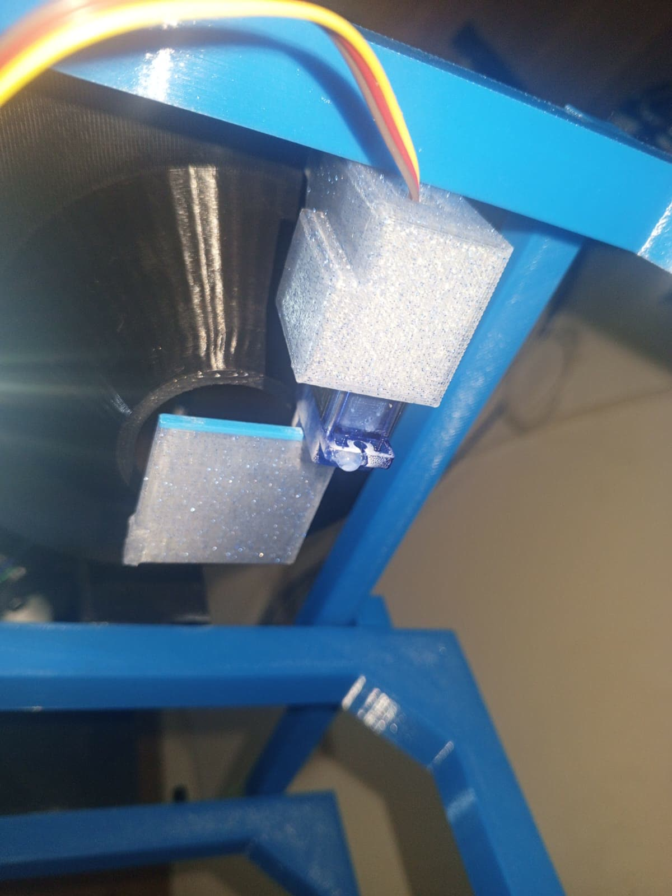

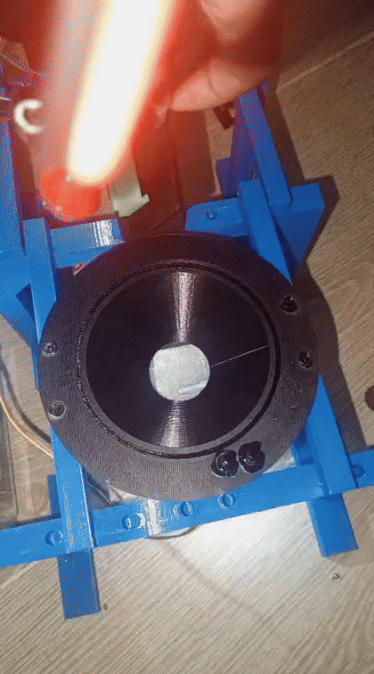

[Ver video](https://johan-c777.github.io/coin-sorting-robot-pybullet/pruebas/etapa1/video/error_puerta.mp4)

### Cartucho y vasos

Funciona: tres módulos C01 unidos por cola de milano, la rampa de rechazo C02 y los 9 vasos.

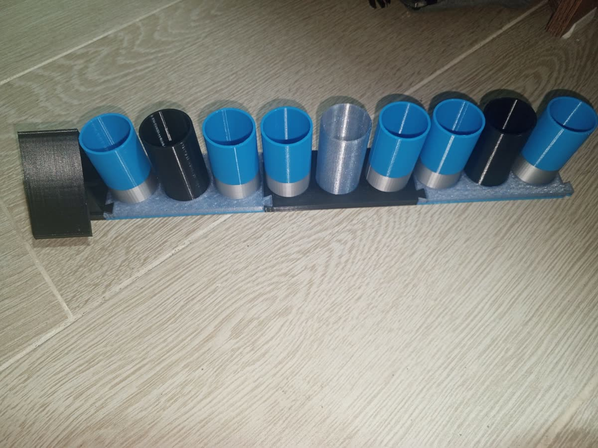

### Montaje general

Torre armada sobre el marco: tolva con el disco de 8 bolsillos, pista L01 con las barreras,
adaptador del TCS3200, embudo y cartucho; ESP32-S3 en su placa de extensión con
protoboard. Hallazgo H6: los jumpers son demasiado cortos.

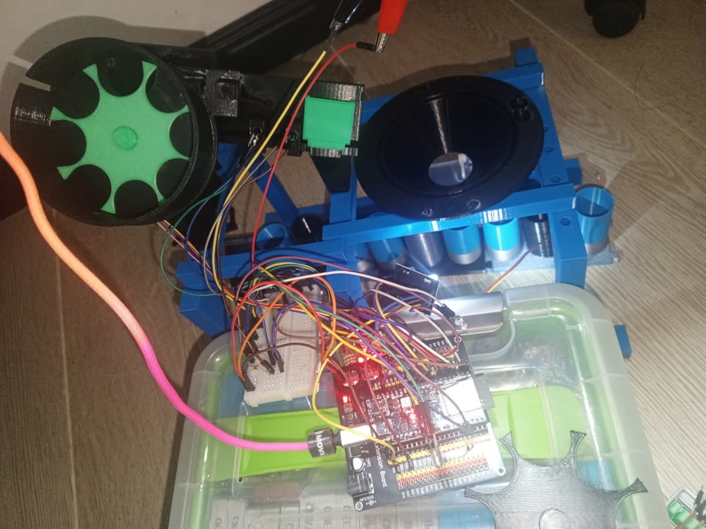

## Siguiente ronda

1. Imprimir el disco de 6 bolsillos con nervios de apoyo (H2, H3), la rampa trasera (H1)
   y la segunda paleta de la compuerta (H4); lijar el portadisco (H3).
2. Ajustar el firmware a 6 bolsillos por vuelta.
3. Con jumpers largos (H6), probar las barreras IR y el TCS3200 y seguir la calibración
   `[CAL-xx]` de la [fase 4 de TODO.md](../TODO.md#fase-4--montaje-y-calibración-física).
4. Repetir las 7 denominaciones y probar la tolva llena (H5).
