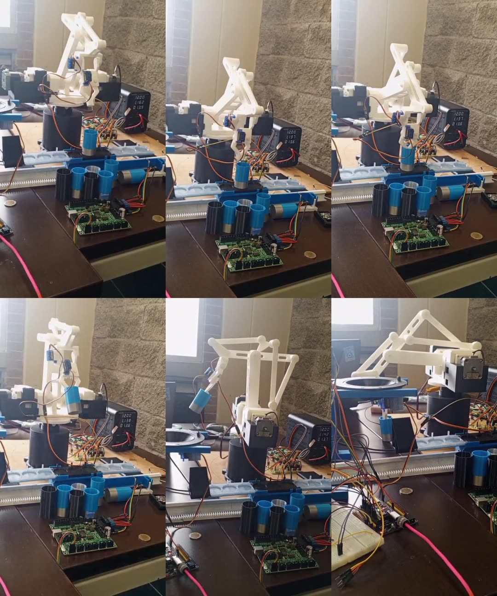
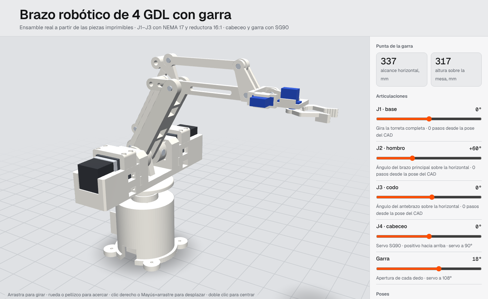
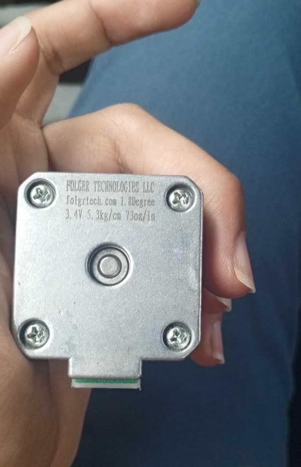
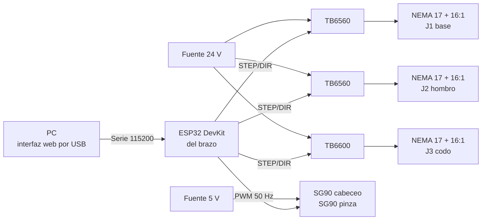
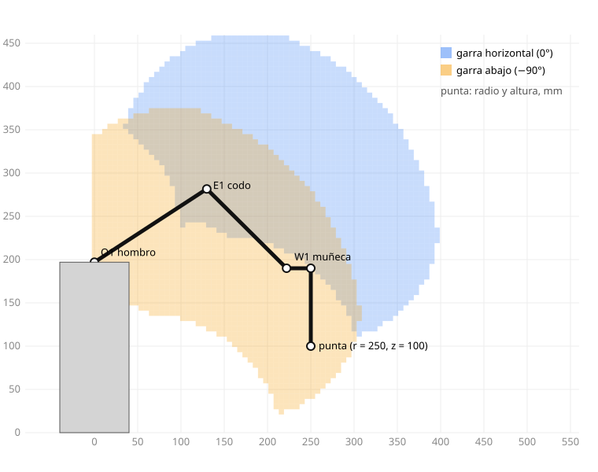

# Etapa 3 · Brazo robótico de 4 GDL

El brazo toma cada vaso del cartucho cuando la banda lo deja en el **punto A** y lo lleva al
**punto B** (el rack donde se ordenan los vasos). Es un brazo de doble paralelogramo con tres
motores paso a paso NEMA 17, cada uno con una reductora planetaria impresa de 16:1, y dos micro
servos SG90 para el cabeceo de la muñeca y la pinza. Lo diseñaron Javier León y Samuel Rubio en
SolidWorks; todas las piezas están impresas en 3D.

<p align="center">
  
  <br><sub>Prueba del brazo armado: baja sobre un vaso del cartucho, lo agarra, lo levanta, gira la base y
  lo deja al otro lado. <a href="pruebas/etapa3/video/brazo_toma_vaso.mp4">Video completo (1 min 41 s)</a>.</sub>
</p>

**[Visor 3D del brazo](https://johan-c777.github.io/coin-sorting-robot-pybullet/visor-brazo-4gdl.html)**:
el ensamble real con las piezas impresas; cada articulación se mueve con un deslizador y el panel
muestra la posición de la punta y los pasos de motor.

<p align="center"><a href="https://johan-c777.github.io/coin-sorting-robot-pybullet/visor-brazo-4gdl.html"></a></p>

**Contenido:** [1. Resumen](#1-resumen) · [2. Mecánica](#2-mecánica) ·
[3. Cálculos](#3-cálculos-de-diseño) · [4. Electrónica](#4-electrónica) ·
[5. Control](#5-control) · [6. Cinemática](#6-cinemática) ·
[7. Integración](#7-integración-con-las-etapas-1-y-2) · [8. Pruebas](#8-pruebas-y-decisiones-de-diseño) ·
[9. Archivos](#9-archivos)

---

## 1. Resumen

| | |
|---|---|
| Tipo | Brazo articulado de doble paralelogramo (familia EEZYbotARM), alcance de la punta ≈ 40 cm |
| Grados de libertad | J1 base · J2 hombro · J3 codo · J4 cabeceo de la muñeca · pinza |
| Actuadores | 3 × NEMA 17 (1,8°, 5,3 kg·cm) con reductora planetaria impresa 16:1 · 2 × SG90 |
| Controlador | ESP32 propia del brazo con 2 drivers TB6560 y 1 TB6600 (24 V) para los NEMA y PWM para los SG90 |
| Medidas (mm) | Eje del hombro a 197 de la base · L₁ = 155 · L₂ = 130 · muñeca a cabeceo 28 · garra 90 |
| Resolución | 200 × 2 × 16 / 360 = **17,8 pasos por grado** de salida (drivers en 1/2 paso) |
| Piezas | 25 STL del brazo, 7 de la garra, 9 de cada reductora; sin piezas compradas salvo motores, servos y tornillos M4 |
| Estado | Impreso, armado y moviéndose: toma un vaso del cartucho y lo traslada (video arriba) |

---

## 2. Mecánica

### 2.1 Cómo se mueve un doble paralelogramo

```
              E1 (codo)
              o─────────────────o W1 (muñeca) ──o eje de cabeceo
             /│   antebrazo L2   │                \
   brazo L1 / │ biela superior   │ soporte 020     \ garra L3
           /  │ (paralela a L1)  │ siempre          \
          /   o─────────────────o horizontal       o punta
     O1  o  escuadra 006
(hombro) │\
         │ \ biela inferior (paralela a L1)
         │  o palanca 002, la mueve J3
       torreta (J1 la gira)
```

- **J2** gira el brazo principal L₁ alrededor del hombro O1.
- **J3** está montado al lado de J2, sobre el mismo eje, y gira una palanca corta (002). Una biela
  paralela a L₁ lleva ese giro hasta la parte trasera del antebrazo (005). Por eso **los dos motores
  pesados quedan quietos en la torreta** y el brazo no carga su peso; el ángulo del antebrazo lo fija
  directamente J3, sin importar dónde esté L₁.
- Un segundo paralelogramo (escuadra 006 + biela superior 003) mantiene el **soporte de la muñeca
  siempre horizontal**. Si el SG90 de cabeceo queda quieto, la garra conserva su orientación en todo
  el recorrido y el vaso no se inclina.
- **J4 (SG90)** inclina la garra respecto a la horizontal, de 0° (al frente) a −90° (hacia abajo). En
  la prueba se usa −90°: la garra baja sobre el vaso y lo toma por arriba.

### 2.2 Reductora planetaria impresa 16:1

Cada NEMA 17 lleva una caja de dos etapas iguales. En una etapa planetaria con la corona fija, el
sol es la entrada y el portaplanetas es la salida:

```
i = 1 + Z_corona / Z_sol = 1 + 30 / 10 = 4        (planetas de 10 dientes: 30 = 10 + 2 × 10)
i_total = 4 × 4 = 16
```

| Pieza | Función |
|---|---|
| 01 brida NEMA 17 | Fija la caja al motor |
| 02 carcasa con corona de 30 dientes | Corona fija de las dos etapas |
| 04 sol de 10 dientes (eje en D de 5 mm) | Entrada, va en el eje del motor |
| 05 planetas de 10 dientes (× 6) y 08 pasadores Ø5 (× 6) | Tres por etapa |
| 06 portaplanetas de la etapa 1 con el sol de la etapa 2 | Une las dos etapas |
| 07 portaplanetas de salida con eje Ø25 | Salida hacia el brazo |
| 03 tapa frontal · 09 arandela de empuje | Cierre y apoyo axial |

La salida es un cilindro de acero de Ø25,6 × 39,3 mm (medido con calibrador, ver
[`referencia_motor.png`](../hardware/etapa3-brazo/brazo/referencia_motor.png)) con un agujero
transversal de Ø12. Las piezas que mueve (brazo 004, palanca 002 y engranaje de la base 016) tienen
un cubo de Ø46 con agujero de Ø26,0 y se traban con un **pasador impreso de Ø11,75** que atraviesa
cubo y eje.

### 2.3 Base, torreta y garra

- **Base 010** (128 × 128 × 112 mm): aloja J1. El engranaje 016 y el plato 011 giran la torreta.
- **Torreta** en tres bloques (04A núcleo, 04B y 04C cunas de J2 y J3) para que quepa en la cama de
  220 mm. Las cunas encajan con chavetas y 4 tornillos M4; cada motor se aprieta con una abrazadera 05
  y 4 tornillos M4.
- **Garra** (carpeta [`garra/`](../hardware/etapa3-brazo/garra)): soporte de muñeca 020 con cuna para
  el SG90 de cabeceo, soporte de pinza 012 y dos dedos con sector dentado; el dedo derecho lo mueve el
  segundo SG90 y arrastra al izquierdo. Las cajeras de las palas se midieron sobre palas reales de 22 mm.
- **Tolerancias FDM:** agujeros de articulación Ø8,30 con pasadores de Ø8,20; dedos Ø4,30 con pasador
  Ø3,80; el CAD se revisó con intersección booleana entre los 48 sólidos del ensamble (0 mm³ de choque,
  [`INFORME_CAD.md`](../hardware/etapa3-brazo/brazo/INFORME_CAD.md)).
- **Volumen impreso:** ≈ 1,7 L sólidos de brazo y garra más 0,36 L de las tres reductoras, calculado
  de los STL; la masa real es menor porque las piezas van con relleno parcial
  ([`GUIA_IMPRESION.md`](../hardware/etapa3-brazo/brazo/GUIA_IMPRESION.md)).

---

## 3. Cálculos de diseño

### 3.1 Par disponible en cada articulación

| Dato | Valor |
|---|---|
| Par de retención del NEMA 17 (placa del motor) | 5,3 kg·cm = 0,52 N·m |
| Reducción | 16 |
| Eficiencia supuesta de dos etapas impresas | 0,6 |
| **Par a la salida** | 0,52 × 16 × 0,6 ≈ **5,0 N·m** |

<p align="center"></p>

### 3.2 Par que pide el hombro (caso más desfavorable)

Brazo estirado en horizontal, punta a 403 mm del hombro. Masas de las piezas móviles con el volumen
de sus STL, PLA de 1,24 g/cm³ y un 60 % de material efectivo:

| Carga | Masa | Brazo de palanca | Momento |
|---|---|---|---|
| Brazo principal 004 | 110 g | 78 mm | 0,084 N·m |
| Antebrazo 005 | 23 g | 220 mm | 0,050 N·m |
| Bielas y escuadra | 20 g | 200 mm | 0,039 N·m |
| Muñeca, garra y 2 SG90 | 55 g | 358 mm | 0,193 N·m |
| Vaso con 10 monedas de $1.000 | 118 g | 403 mm | 0,466 N·m |
| **Total** | | | **≈ 0,83 N·m** |

Factor de seguridad sobre el par de retención: 5,0 / 0,83 ≈ **6**. Al moverse el par del motor baja
con la velocidad, por eso se usan aceleraciones bajas. El paralelogramo pasa parte de la carga del
antebrazo a J3, así que el caso real del hombro es menor que el de la tabla.

### 3.3 Pinza

El SG90 da ≈ 1,8 kg·cm (0,18 N·m). Con dedos de ≈ 60 mm, cada dedo aprieta con ≈ 2,9 N. Con un
rozamiento PLA-polipropileno de μ ≈ 0,3, la masa que sostiene sin resbalar es

```
m = 2 · μ · F / g = 2 × 0,3 × 2,9 / 9,81 ≈ 0,18 kg
```

Es un vaso con unas 15 monedas de $1.000. Un vaso lleno (40 monedas, ≈ 430 g) no se sostiene: se
limita la carga por vaso o se añaden almohadillas de TPU para subir μ.

### 3.4 Resolución y precisión

- 1 paso = 1 / 17,8 = 0,056° en la articulación, es decir **0,39 mm en la punta** a 400 mm: sobra
  para tomar un vaso de 34 mm. Con 1/8 de paso bajaría a 0,1 mm.
- El juego de los engranajes impresos y del pasador del eje se compensa llegando a cada posición
  siempre desde el mismo sentido.

---

## 4. Electrónica

El brazo tiene **su propio controlador**, independiente de las etapas 1 y 2 (la etapa 1 usa una
ESP32-S3 y la banda una RAMBo con Marlin). Así cada módulo se prueba y se ajusta por separado.



| Señal | GPIO | Va a |
|---|---|---|
| J1 STEP / DIR | 26 / 25 | CLK+ / CW+ del driver de la base |
| J2 STEP / DIR | 33 / 32 | CLK+ / CW+ del driver del hombro |
| J3 STEP / DIR | 27 / 14 | CLK+ / CW+ del driver del codo |
| Enable común | 13 | EN+ de los tres drivers (activo en bajo) |
| Servo de cabeceo | 18 | Señal del SG90 de la muñeca |
| Servo de la pinza | 19 | Señal del SG90 de la pinza |

Se evitaron los pines de arranque (0, 2, 5, 12, 15), los de solo entrada (34-39) y los de la flash
(6-11). `CLK−` y `CW−` de cada driver van a GND de la ESP32.

**Ajuste de los drivers a 24 V** (con la fuente apagada antes de mover un interruptor):

| Driver | Corriente 1,9 A | Micropasos 1/2 | Otros |
|---|---|---|---|
| TB6560 (× 2) | SW1 ON, SW2 ON, SW3 OFF, S1 ON | S3 ON, S4 OFF | S2 OFF (par de reposo 50 %); decay 50 %: S5 OFF, S6 ON |
| TB6600 | S4 ON, S5 ON, S6 OFF | S1 OFF, S2 ON, S3 ON | — |

**Alimentación:** 24 V a los drivers con cable de 18-22 AWG; 5 V aparte para los SG90 (no desde el
3V3 de la ESP32); todas las tierras unidas. Detalle en la
[guía de conexiones](../hardware/etapa3-brazo/firmware/ESP32_Calibracion_Robot4GDL/GUIA_CONEXIONES_Y_CALIBRACION.md).

---

## 5. Control

El firmware ([`ESP32_Calibracion_Robot4GDL.ino`](../hardware/etapa3-brazo/firmware/ESP32_Calibracion_Robot4GDL))
no usa librerías externas. Cada eje tiene una rampa trapezoidal que se actualiza cada 1 ms, con pulsos
de 20 µs (los TB6560/TB6600 piden al menos 5 µs) y 800 pasos/s y 2.500 pasos/s² por defecto. Los
comandos llegan por USB a 115200 baudios y la placa responde su estado en JSON cada 100 ms mientras
se mueve.

| Comando | Qué hace |
|---|---|
| `ENABLE 1` / `ENABLE 0` | Activa o suelta los tres motores |
| `GOTO <eje> <pasos>` | Lleva el eje 0 (J1), 1 (J2) o 2 (J3) a una posición absoluta |
| `MOVE <eje> <pasos>` | Movimiento relativo |
| `ZERO <eje>` | Fija el cero en la posición actual |
| `LIMIT <eje> MIN` / `MAX` | Guarda los topes seguros de cada eje |
| `SPEED <pasos/s>` · `STOP` · `STATUS` | Velocidad, parada y estado |

**Calibración.** Con la interfaz web (`servidor_serial.py` + `interfaz_calibracion.html`) se lleva
cada eje a su pose de cero (base al frente, brazo vertical, antebrazo horizontal), se fija con `ZERO`,
se marcan los topes de cada lado y todo queda guardado en la memoria de la ESP32 y en
`robot_4gdl_calibracion.json`.

**De la pose a los pasos.** [`software/brazo/brazo4gdl.py`](../software/brazo/brazo4gdl.py) resuelve la
cinemática inversa y convierte cada ángulo en pasos desde el cero. Ejemplo: tomar un vaso a 250 mm del
eje y 100 mm de altura con la garra hacia abajo:

```python
from brazo import brazo4gdl as b
b.comandos_secuencia([b.Pose(250, 0, 100, -90)])
# ['ENABLE 1', 'GOTO 0 0', 'GOTO 1 -1011', 'GOTO 2 -797']   θ₂ = 33,1°, θ₃ = −44,8°
```

---

## 6. Cinemática

### 6.1 Directa

Con el paralelogramo, θ₂ (brazo) y θ₃ (antebrazo) son **ángulos absolutos** medidos desde la
horizontal, no relativos entre sí como en un brazo en serie. φ es el cabeceo de la garra.

```
ρ = L₁ cos θ₂ + L₂ cos θ₃ + L_p + L₃ cos φ
z = h + L₁ sen θ₂ + L₂ sen θ₃ + L₃ sen φ
x = ρ cos θ₁        y = ρ sen θ₁
```

con h = 197 mm, L₁ = 155, L₂ = 130, L_p = 28 y L₃ = 90.

### 6.2 Inversa (cerrada)

```
θ₁ = atan2(y, x)
r_w = ρ − L_p − L₃ cos φ          z_w = z − h − L₃ sen φ          (muñeca W1 respecto al hombro)
cos q = (r_w² + z_w² − L₁² − L₂²) / (2 L₁ L₂)
θ₂ = atan2(z_w, r_w) + atan2(L₂ sen q, L₁ + L₂ cos q)
θ₃ = θ₂ − q
```

Solo existe la solución de codo arriba: el paralelogramo no deja que el antebrazo pase por debajo del
brazo. Las pruebas ([`test_brazo4gdl.py`](../software/tests/test_brazo4gdl.py)) comprueban la ida y
vuelta directa → inversa en 300 poses al azar dentro de los límites.

### 6.3 Espacio de trabajo

<p align="center"></p>

| Altura de la punta | Garra hacia abajo (−90°) | Garra horizontal (0°) |
|---|---|---|
| 60 mm | 196 a 274 mm | — |
| 100 mm | 162 a 298 mm | — |
| 150 mm | 9 a 305 mm | 286 a 364 mm |
| 200 mm | 0 a 292 mm | 239 a 392 mm |

Radio medido desde el eje de J1; alturas desde la cara inferior de la base. Los límites de cada
articulación son estimados del CAD (J2 15° a 165°, J3 −75° a 60°, ángulo del codo 20° a 165°) y se
ajustan con la calibración física. La figura se regenera con `python scripts/brazo4gdl_espacio.py`.

---

## 7. Integración con las etapas 1 y 2

1. La **etapa 1** clasifica cada moneda en su vaso del cartucho.
2. La **etapa 2** mueve el cartucho por la barra dentada y deja el vaso pedido en el punto A.
3. El brazo, con su propia ESP32, baja sobre el vaso, cierra la pinza, sube, gira la base, baja en
   el puesto del rack y abre. Cada módulo tiene su controlador; la secuencia completa se coordina
   enviando a la ESP32 del brazo el número de vaso y su puesto en el rack.
4. El orden del rack (por valor, cantidad, peso o monedas antiguas) lo decide el software de
   [`software/brazo/`](../software/brazo) con el lote `VASOS:` que entrega la etapa 1
   ([04-protocolo.md](04-protocolo.md)).

**Ubicación:** el punto A debe quedar en el anillo de agarre (≈ 160 a 300 mm del eje de J1 con la
garra hacia abajo). El rack de 9 vasos va en un arco dentro del mismo anillo; a 270 mm de radio y
9,5° entre puestos quedan 45 mm entre centros para vasos de 34 mm.

La ruta entre los cuatro obstáculos del punto A al B ([08-obstaculos.md](08-obstaculos.md)) se
diseñó y probó con el modelo simulado de 5 servos; se adapta a este brazo cambiando su cinemática
por la de `brazo4gdl.py`.

---

## 8. Pruebas y decisiones de diseño

| Prueba | Resultado |
|---|---|
| Movimiento de J1, J2 y J3 con su ESP32 y sus drivers | ✅ Los tres ejes se mueven con rampa suave |
| Agarre de un vaso del cartucho desde arriba | ✅ Lo toma, lo levanta y lo traslada al otro lado de la base (video) |
| Garra horizontal durante el traslado | ✅ El paralelogramo la mantiene; el vaso no se inclina al subir |
| Interfaz con las etapas 1 y 2 | Definida: el brazo recibe el número de vaso y su puesto en el rack (trama `VASOS:`) |

| Decisión | Por qué |
|---|---|
| Reductora planetaria impresa 16:1 | Multiplica por ≈ 10 el par del NEMA 17 sin comprar cajas reductoras |
| Motores fijos en la torreta y doble paralelogramo | El brazo no carga el peso de los motores y la garra queda horizontal sin control |
| Controlador propio del brazo | Cada etapa se prueba y calibra por separado |
| Cero fijado con la interfaz de calibración | Diseño más simple, sin finales de carrera; los ceros quedan guardados en la ESP32 |
| Carga por vaso acotada a ≈ 0,18 kg | Capacidad de agarre del SG90 (§ 3.3); la pinza admite almohadillas de TPU para subirla |
| Cinemática propia (`brazo4gdl.py`) | El modelo de la simulación era de 5 servos; el brazo real usa sus medidas del CAD |

---

## 9. Archivos

| Qué | Dónde |
|---|---|
| Piezas del brazo (STL, STEP, ensamble, scripts generadores) | [`hardware/etapa3-brazo/brazo/`](../hardware/etapa3-brazo/brazo) |
| Garra SG90 (STL y SolidWorks nativo) | [`hardware/etapa3-brazo/garra/`](../hardware/etapa3-brazo/garra) |
| Reductora planetaria 16:1 | [`hardware/etapa3-brazo/reductora/`](../hardware/etapa3-brazo/reductora) |
| Firmware del brazo (ESP32: calibración y prueba de motores) | [`hardware/etapa3-brazo/firmware/`](../hardware/etapa3-brazo/firmware) |
| Lista de materiales | [`hardware/etapa3-brazo/bom.csv`](../hardware/etapa3-brazo/bom.csv) |
| Cinemática y comandos del brazo | [`software/brazo/brazo4gdl.py`](../software/brazo/brazo4gdl.py) |
| Video y fotos de la prueba | [`docs/pruebas/etapa3/`](pruebas/etapa3) |
| Brazo anterior de 5 servos (simulación) | [`hardware/archivo/etapa3-brazo-v1/`](../hardware/archivo/etapa3-brazo-v1), [02-cinematica.md](02-cinematica.md) |
