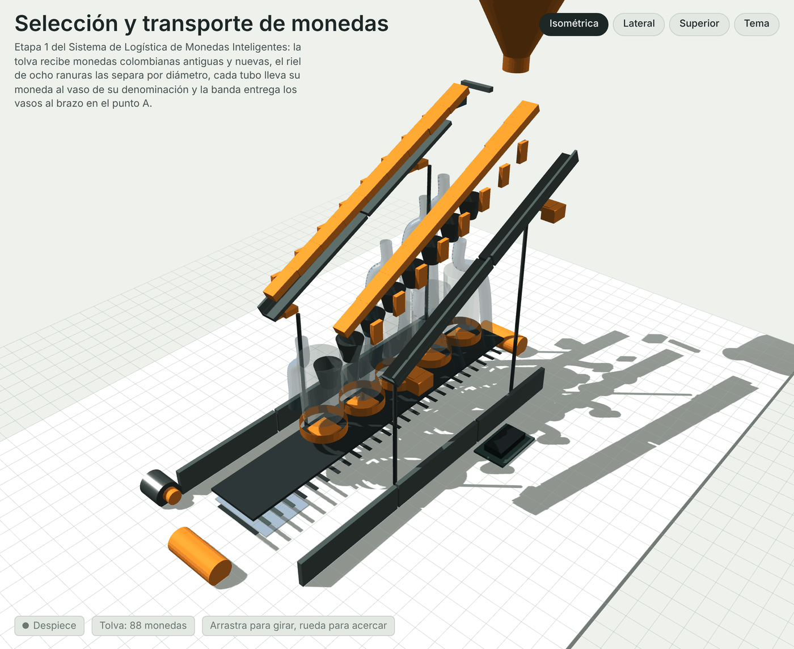

# Despiece de la etapa 1 (versión 1, archivada)

> **Diseño reemplazado.** Esta fue la primera etapa 1 (riel de 8 estaciones con varillas M5 y tornillos). La versión que se imprime ahora está en [09-clasificador-fisico.md](../09-clasificador-fisico.md) y su guía de armado en [10-guia-armado-etapa1.md](../10-guia-armado-etapa1.md).



La misma vista se mueve en vivo desde la simulación
([`simulacion-etapa1.html`](../simulacion-etapa1.html), pestaña **Despiece**): el
deslizador separa las piezas y al tocar una de la lista se aísla y muestra su ficha.

En esta entrega el riel pasó de 5 a **8 estaciones** para recibir monedas
antiguas y nuevas (ver [07-monedas.md](../07-monedas.md)). Los STL y el proyecto 3MF
ya están regenerados con esa geometría.

## Piezas impresas

Los archivos están en [`hardware/archivo/etapa1-v1/stl/`](../../hardware/archivo/etapa1-v1/stl) y el
resumen con triángulos y ajustes en `stl/piezas.csv`.

| Código | Pieza | Cant. | Archivo | Medidas | Material y ajustes |
| --- | --- | --- | --- | --- | --- |
| P01 | Riel selector, tramo de entrada (ranuras 1 a 4) | 2 | `E01_riel_tramo_a.stl` | 200 x 22 x 10 mm | PETG, 0,2 mm, 4 perímetros, 40 % |
| P02 | Riel selector, tramo de salida (ranuras 5 a 8) | 2 | `E02_riel_tramo_b.stl` | 180 x 18,6 x 10 mm | PETG, 0,2 mm, 4 perímetros, 40 % |
| P03 | Canal del costado | 4 | `E03_canal_costado.stl` | 180 x 22 x 20 mm | PETG, 0,2 mm, 3 perímetros, 30 % |
| P04 | Abrazadera de varilla M5 | 4 | `E04_abrazadera_varilla.stl` | 38 x 20 x 14 mm | PETG, 0,2 mm, 4 perímetros, 40 % |
| P05 | Tolva de alimentación | 1 | `E05_tolva.stl` | 124 x 110 x 93 mm | PLA o PETG, 0,25 mm, 3 perímetros, 15 % |
| P06 | Paleta dosificadora | 1 | `E06_paleta_dosificadora.stl` | 18 x 60 x 9 mm | PETG, 0,2 mm, 4 perímetros, 60 % |
| P07 | Embudo de estación con espiga | 8 | `E07_embudo_estacion.stl` | 35 x 35 x 44 mm | PLA, 0,2 mm, 3 perímetros, 15 % |
| P08 | Soporte de sensor infrarrojo | 8 | `E08_soporte_sensor.stl` | 34 x 16 x 27 mm | PETG, 0,2 mm, 3 perímetros, 30 % |
| P09 | Rodillo de la banda | 2 | `E09_rodillo_banda.stl` | 35 x 35 x 70 mm | PETG, 0,2 mm, 4 perímetros, 30 % |
| P10 | Marco de la banda, tramo | 6 | `E10_marco_banda.stl` | 193 x 64 x 18 mm | PETG, 0,2 mm, 3 perímetros, 25 % |
| P11 | Portavaso | 5 | `E11_portavaso.stl` | 58 x 58 x 15 mm | PETG, 0,2 mm, 3 perímetros, 20 % |
| P12 | Acople motor a rodillo | 1 | `E12_acople_motor.stl` | 18 x 18 x 24 mm | PETG, 0,2 mm, 5 perímetros, 60 % |
| P13 | Pie nivelador | 8 | `E13_pie_nivelador.stl` | 22 x 22 x 14 mm | TPU o PETG, 0,2 mm, 3 perímetros, 30 % |

Ninguna pieza pasa de 204 mm, así que todas caben en una cama de 220 x 220 mm con
margen, y se imprimen sin soportes en la orientación del STL. El proyecto
[`sistema_monedas_completo.3mf`](../../hardware/archivo/etapa1-v1/sistema_monedas_completo.3mf)
trae las 58 piezas de la celda repartidas en 9 bandejas por material.

## Piezas compradas

| Código | Elemento | Cant. | Nota |
| --- | --- | --- | --- |
| C01 | Servo SG90 | 1 | Mueve la paleta dosificadora, comandado por PWM desde el ESP32 |
| C02 | Barrera infrarroja | 8 | Una por estación; la estación dice denominación y familia de la moneda |
| C03 | Motorreductor 12 V y cinta de 70 mm | 1 | Banda transportadora, con puente H L298N |
| C04 | Vaso de polipropileno de 52 mm | 5 | Uno por denominación; el mismo que recoge el brazo |
| C05 | Varilla roscada M5 con tuercas | 4 | Da la altura del riel y permite ajustar la inclinación |
| C06 | Tubo flexible de PVC cristal de 3/4" | 8 | Colector de cada estación hacia el vaso de su denominación |

Detalle con cantidades y tornillería en
[`hardware/etapa1-clasificador/bom-etapa1.csv`](../../hardware/etapa1-clasificador/bom-etapa1.csv).

## Cómo se arma

1. **Rieles.** Unir P01 y P02 por la solapa a media madera (20 mm) con dos M3 x 12
   y tuerca embebida. Quedan dos rieles de 360 mm; el derecho es el mismo STL
   volteado sobre su eje largo.
2. **Canales.** Atornillar dos P03 por lado a lo largo del riel, con tres M3 x 10
   cada uno. El riel entra en el canal y queda enrasado con la pared.
3. **Altura.** Montar las cuatro P04 sobre varilla roscada M5 y ajustar con
   tuercas hasta que el riel quede a 340 mm en la entrada y 188 mm en la salida:
   son los 25 grados de inclinación.
4. **Comprobación de la luz.** Antes de seguir, pasar una moneda de cada tipo
   (las ocho) por el riel. Cada una debe caer en su estación y ninguna antes. La
   estación 4 ($200 nueva) es la crítica: ver la calibración de abajo.
5. **Tolva.** Fijar P05 sobre la entrada del riel con dos M3, montar el servo
   SG90 con P06 en el eje y ajustar los topes por firmware
   (`SERVO_CERRADO_US` y `SERVO_ABIERTO_US`).
6. **Embudos y colectores.** Colgar un P07 bajo cada ranura con cuatro M3 y
   encajar en su espiga un tubo flexible de 3/4". Cada tubo baja al vaso de su
   denominación según la tabla siguiente; los de las monedas antiguas van por
   detrás del riel y los de las nuevas por delante, para que no se crucen.
7. **Sensores.** Montar los P08 a cada lado de la ranura, con el emisor y el
   receptor enfrentados y el haz cruzando el centro del hueco. Conectar cada
   barrera al pin de su estación (`PIN_SENSOR` en `firmware/esp32_contador/config.h`).
8. **Banda.** Unir tres P10 por lado con las solapas, montar los dos P09 sobre
   ejes de 5 mm, tensar la cinta y acoplar el motor con P12. Los cinco P11 van
   sobre la cinta separados 65 mm, en el orden $50, $100, $200, $500 y $1.000.
9. **Pies.** Poner los P13 y nivelar con un nivel de burbuja: si el riel no está
   a escuadra, las monedas se recuestan contra un lado y se traban.

### Estación, tubo y vaso

| Estación | Moneda | Familia | Vaso | Lado del tubo |
| --- | --- | --- | --- | --- |
| 1 | $50 | nueva | $50 | delante |
| 2 | $100 | nueva | $100 | delante |
| 3 | $50 | antigua | $50 | detrás |
| 4 | $200 | nueva | $200 | delante |
| 5 | $100 | antigua | $100 | detrás |
| 6 | $500 | las dos | $500 | centro |
| 7 | $200 | antigua | $200 | detrás |
| 8 | $1.000 | nueva | $1.000 | delante |

## Tolerancias y calibración

Cada luz queda entre el diámetro de su moneda y el de la siguiente:
`luz = d + min(0,6 mm; mitad del hueco)`, redondeada a 0,05 mm.

| Estación | Moneda | Diámetro | Luz | Holgura para caer | Margen contra la siguiente |
| --- | --- | --- | --- | --- | --- |
| 1 | $50 nueva | 17,00 mm | 17,60 mm | 0,60 mm | 2,70 mm |
| 2 | $100 nueva | 20,30 mm | 20,90 mm | 0,60 mm | 0,60 mm |
| 3 | $50 antigua | 21,50 mm | 21,95 mm | 0,45 mm | 0,45 mm |
| 4 | $200 nueva | 22,40 mm | 22,70 mm | **0,30 mm** | **0,30 mm** |
| 5 | $100 antigua | 23,00 mm | 23,35 mm | 0,35 mm | 0,35 mm |
| 6 | $500 (las dos) | 23,70 mm | 24,05 mm | 0,35 mm | 0,35 mm |
| 7 | $200 antigua | 24,40 mm | 25,00 mm | 0,60 mm | 1,70 mm |
| 8 | $1.000 nueva | 26,70 mm | 27,30 mm | 0,60 mm | — |

Con las dos familias el riel queda mucho más apretado que con una sola: entre la
$200 nueva (22,4 mm) y la $100 antigua (23,0 mm) solo hay 0,6 mm, y la ranura 4
tiene que repartirlos. Eso está al límite de una impresora FDM, así que:

- Antes de imprimir los rieles completos, sacar una **probeta de 40 mm de las
  estaciones 3 a 6** y medir cada luz con calibrador. Si la impresora saca las
  paredes anchas, compensar el flujo o ajustar `HOLGURA_MAX_MM` y
  `SEPARACION_MINIMA_MM` en `software/brazo/monedas.py` y regenerar.
- Si la probeta no da la precisión, la salida es cortar los tramos de las
  estaciones 3 a 6 en acrílico con láser (±0,1 mm) y dejar el resto impreso.

Otros puntos que valen la calibración:

- **Inclinación.** Con 25 grados la moneda desliza sola sobre PETG. Si se queda
  pegada, lijar el canal en el sentido del avance o subir a 27 grados; si salta,
  bajar a 23.
- **Rebote del sensor.** `REBOTE_US` está en 25 ms. Si el conteo sube de a dos,
  subirlo; si se pierden monedas seguidas, bajarlo.
- **Cierre del dosificador.** `SERVO_MS_ABIERTO` controla cuántas monedas pasan
  por ciclo. Se ajusta hasta que pase una sola.

## Regenerar las piezas

```bash
python scripts/generar_stl.py      # 15 STL y stl/piezas.csv
python scripts/generar_3mf.py      # 58 piezas en 9 bandejas
```

El script lee las luces de `software/brazo/monedas.py`, así que un cambio en el
catálogo de monedas o en las holguras se propaga a los STL, al firmware (lo
comprueba `test_el_firmware_del_contador_usa_el_mismo_riel`) y a la
documentación sin copiar números a mano.
