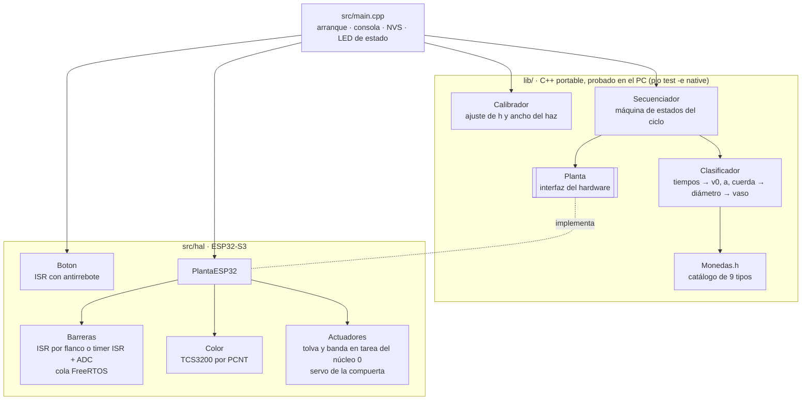
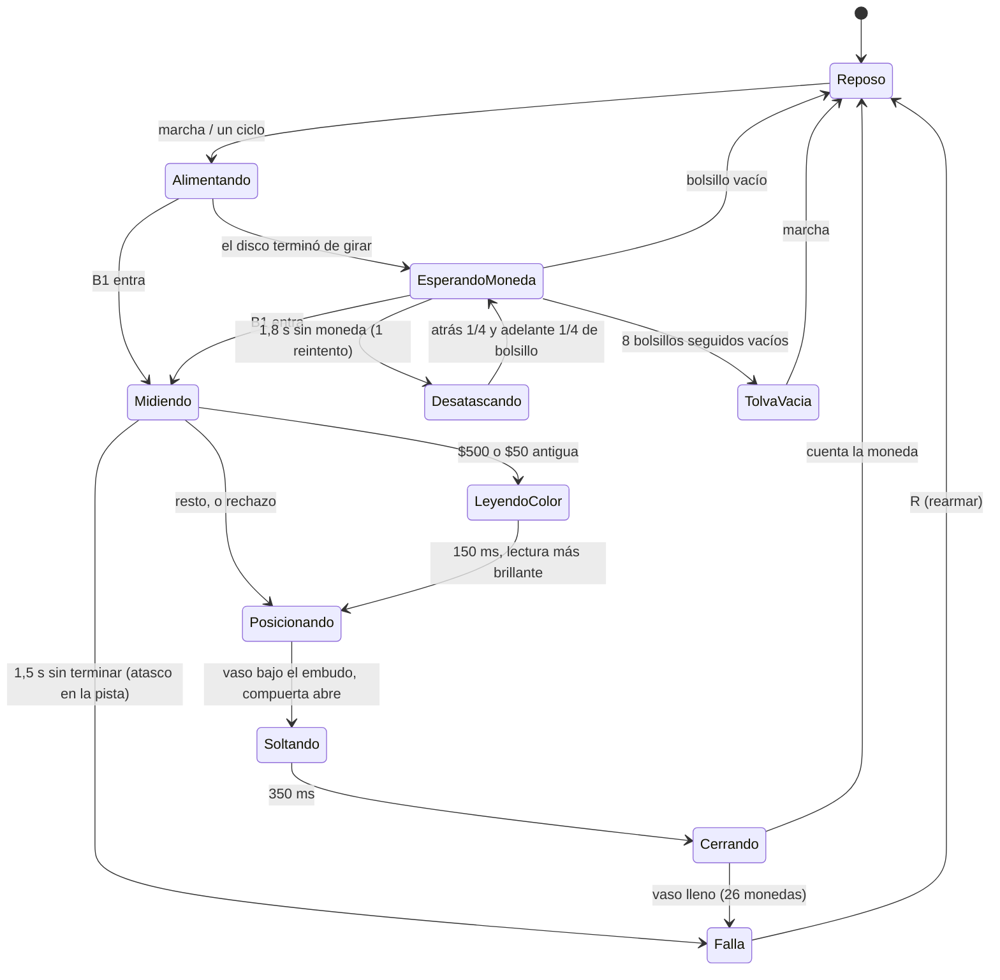

# Firmware del módulo clasificador (etapa 1)

ESP32-S3-DevKitC-1 · Arduino sobre ESP-IDF · PlatformIO · C++17

Controla la torre de canto v5: tolva de disco, dos barreras IR que miden el diámetro de
cada moneda por tiempo de vuelo, sensor de color TCS3200 para las $500, compuerta SG90 y
(cuando se monte) la banda que pone el vaso correcto bajo el embudo.

```bash
pio run -e esp32s3 -t upload && pio device monitor   # firmware a la placa
pio test -e native                                    # 16 pruebas en el PC, sin placa
```

> `firmware/etapa1_prueba_motor/` sigue siendo el banco de pruebas de motores y sensores
> con el que se hicieron las primeras mediciones; este proyecto es el firmware de operación.

## Arquitectura



| Capa | Archivos | Qué hace |
|---|---|---|
| Catálogo | `lib/Clasificacion/Monedas.h` | Las 9 monedas (diámetro, espesor, masa, familia) en el orden de los vasos del cartucho. Una prueba en Python lo compara con `software/brazo/monedas.py`. |
| Medición | `lib/Clasificacion/Clasificador.*` | Resuelve velocidad, aceleración y cuerda con los 4 instantes de las barreras (modelo de aceleración constante, el mismo de `sim/mujoco/rodar.py`) y convierte la cuerda en diámetro. |
| Decisión | `lib/Clasificacion/Clasificador.*` | Vecino más cercano con tolerancia propia de cada clase; el color separa las $500 y descarta la $1.000 de 1996. |
| Calibración | `lib/Clasificacion/Calibrador.*` | Ajusta por mínimos cuadrados la altura y el ancho efectivos del haz con monedas conocidas. |
| Ciclo | `lib/Secuenciador/*` | Máquina de estados no bloqueante; el tiempo se inyecta, así que se prueba completa en el PC con una planta simulada. |
| Hardware | `src/hal/*` | ISR, timer, PCNT, pasos con rampa, servo, pulsador. |
| Configuración | `include/pines.h`, `include/config.h`, `include/calibracion.h` | Pines, tiempos y valores de fábrica de la calibración, cada uno con su etiqueta `[CAL-xx]`. |

## Medición del diámetro

La moneda rueda de canto por la pista L01 (22°). Cada barrera es un LED IR y un
fototransistor enfrentados a través de la placa, con el haz a **h = 10 mm** sobre la repisa
y **24 mm** entre las dos barreras. Mientras la moneda pasa, tapa el haz a lo largo de la
cuerda que corta a esa altura:

```
c = 2·sqrt(h·(D − h))      ⇔      D = h + c² / (4h)
```

Con los cuatro instantes (entra y sale en B1 y B2) y aceleración constante se resuelven
`v0`, `a` y `c` sin suponer velocidad constante:

```
v0·T          + a·T²/2           = L      (el borde delantero va de B1 a B2)
v0·τ1         + a·τ1²/2      − c = 0      (la moneda tapa B1 durante τ1)
v0·(T + τ2)   + a·(T + τ2)²/2 − c = L      (el borde trasero sale de B2)
```

En la simulación de MuJoCo este estimador da un error de 0,03 mm; las monedas más
parecidas difieren 0,6 mm. Las lecturas físicamente imposibles (velocidad o aceleración
fuera de rango, flancos en desorden, una segunda moneda pegada) van a rechazo con su motivo.

### Tolerancia por clase

| Vaso | Moneda | Diámetro (mm) | Vecino más cercano (mm) | Tolerancia (mm) |
|---|---|---|---|---|
| 0 | $50 nueva | 17,00 | 3,30 | 0,60 |
| 1 | $100 nueva | 20,30 | 1,20 | 0,55 |
| 2 | $50 antigua | 21,50 | 0,90 | 0,40 |
| 3 | $200 nueva | 22,40 | 0,60 | 0,25 |
| 4 | $100 antigua | 23,00 | 0,60 | 0,25 |
| 5 | $500 antigua | 23,70 | 0,70 | 0,30 |
| 6 | $500 nueva | 23,70 | 0,70 | 0,30 |
| 7 | $200 antigua | 24,40 | 0,70 | 0,30 |
| 8 | $1.000 nueva | 26,70 | 2,30 | 0,60 |

Tolerancia = min(0,60, vecino/2 − 0,05). Así ninguna medida puede caer en dos clases.
Las dos $500 miden lo mismo y las separa el TCS3200; la $1.000 de 1996 (21,67 mm) cae en
la clase de la $50 antigua y se rechaza por ser dorada.

## Máquina de estados



`actualizar(millis())` corre en cada vuelta de `loop()` y nunca bloquea. El paro de
emergencia (`e` o pulsador sostenido 2 s) lleva a `Falla` desde cualquier estado, suelta
la tolva, detiene la banda y cierra la compuerta.

## Interrupciones y tiempo real

| Fuente | Mecanismo | Por qué |
|---|---|---|
| Barreras B1 y B2, modo ADC (por defecto) | Timer por hardware a 4 kHz → ISR marca el instante y notifica a una tarea de prioridad 5 que lee el ADC con base adaptativa e histéresis | Funciona con cualquier fototransistor; 250 µs entre muestras ≈ 0,12 mm a 500 mm/s |
| Barreras B1 y B2, modo digital | ISR por flanco (`CHANGE`) con antirrebote de 300 µs; lee el registro `GPIO_IN_REG` (seguro en IRAM) | Resolución de 1 µs si el fototransistor satura; se activa con `-DBARRERAS_MODO=1` |
| Haz de referencia de la banda | ISR por flanco de bajada | Cero del cartucho (etapa 2) |
| TCS3200 | Contador PCNT por hardware | La salida llega a cientos de kHz: una ISR por flanco saturaría la CPU |
| Pulsador | ISR por flanco con antirrebote de 30 ms | Corta = marcha/pausa, larga = paro |
| Motores | Tarea dedicada en el núcleo 0 con rampa trapezoidal | La máquina de estados en el núcleo 1 nunca espera un paso |
| `loop()` | Watchdog (`enableLoopWDT`) | Si algo se cuelga más de 5 s, la placa se reinicia |

Los eventos de las barreras viajan por una cola de FreeRTOS de 32 posiciones; el contador
`eventos perdidos` (comando `i`) debe quedar en 0.

## Consola serie (115200)

| Comando | Acción |
|---|---|
| `a` | automático on/off |
| `d` | un ciclo |
| `e` / `R` | paro de emergencia / rearmar |
| `i` / `r` | estado y calibración / resumen y trama `VASOS:` |
| `f` / `b` | un bolsillo adelante / atrás |
| `o` / `p` / `w<grados>` | abrir / cerrar / ángulo libre de la compuerta |
| `v` `k` `s` + número | vmax, aceleración y v0 de la tolva |
| `t` | barrido de velocidad de la tolva |
| `m` | monitor de barreras y color a 5 Hz |
| `x<vaso>` | vaciar un vaso (`x-1` todos) |
| `z<vaso>` | banda al vaso (con `HABILITAR_BANDA 1`) |
| `c<vaso>`, `C` | calibración del haz con monedas conocidas |
| `u<umbral>` | umbral de dorado del TCS3200 |
| `g` / `l` / `F` | guardar / cargar / borrar la calibración en flash (NVS) |

Salidas por moneda (las lee el brazo y la app, ver [04-protocolo.md](../../docs/04-protocolo.md)):

```
#D n=12 v0=301 a=2448 c=21.76 D=22.42 razon=0.00 -> N200 (ok)
M:200,3,nueva
R:sin coincidencia,25.31
VASOS:50x3a1,100x2,200x4a1,500x2a1,1000x1
```

## Calibración

Todos los valores que dependen del prototipo armado tienen una etiqueta `[CAL-xx]` en
`include/` y aparecen en [TODO.md](../../TODO.md) (fase 4). Ninguno se ha medido todavía
con piezas reales: hoy valen lo que dicen el CAD y la simulación.

| Etiqueta | Parámetro | Valor de fábrica | Cómo se calibra |
|---|---|---|---|
| CAL-01 | Separación entre haces | 24,0 mm | Calibrador entre los centros de los agujeros de L01 |
| CAL-02, CAL-03 | Altura y ancho efectivos del haz | 10,0 mm y 0 | `c<vaso>` + 3 o más monedas de cada uno de 3 o más tipos, luego `C` y `g` |
| CAL-04 | Tolerancia máxima | 0,60 mm | Si el error RMS de `C` pasa de 0,10 mm, bajarla |
| CAL-05 | Umbral de dorado | 1,30 | Monitor `m` con una $500 antigua y una nueva frente a A01; punto medio, `u<valor>` |
| CAL-06 | Rangos de v y a | 50–2000 mm/s, −2–9,8 m/s² | Leer `#D` con monedas reales y cerrar los rangos |
| CAL-07 | Modo de las barreras | ADC | Si `m` muestra niveles limpios (≈ 0 y ≈ 4095), compilar con `BARRERAS_MODO=1` |
| CAL-08 | Umbrales del ADC | 50 % / 70 % de la base | Monitor `m`: la moneda debe bajar la lectura bien por debajo del 50 % |
| CAL-09 | Velocidad de la tolva | 800 pasos/s | Barrido `t` con la tolva cargada; usar el 75 % del límite |
| CAL-10 | Ángulos y tiempo de la compuerta | 0° / 60°, 350 ms | `w<grados>` hasta paleta horizontal y caída limpia |
| CAL-11 | Posiciones de la banda | paso 40 mm, rechazo 342 mm | Con la banda montada, `z<vaso>` y medir |
| CAL-12 | Llegada a la compuerta | 500 ms | Video a cámara lenta del fin de pista a la paleta |

## Pines

Ver [`include/pines.h`](include/pines.h) y el
[esquema de conexiones](../../hardware/etapa1-clasificador/esquematico/README.md).
