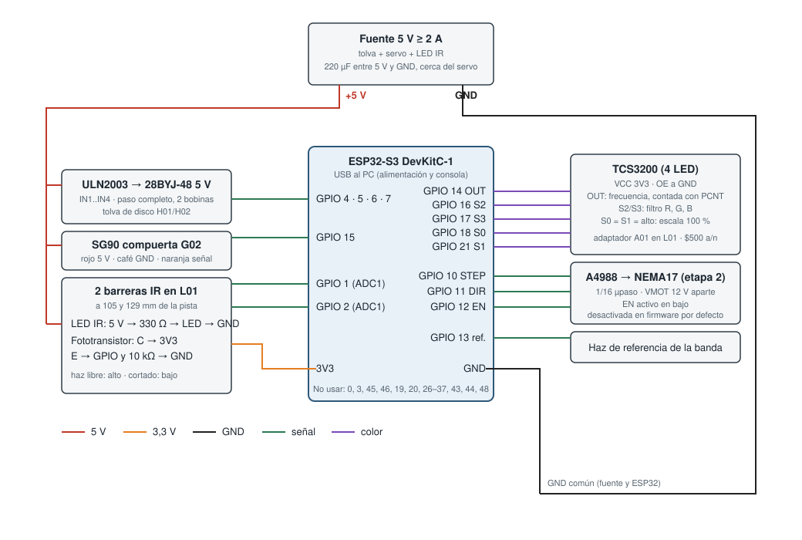
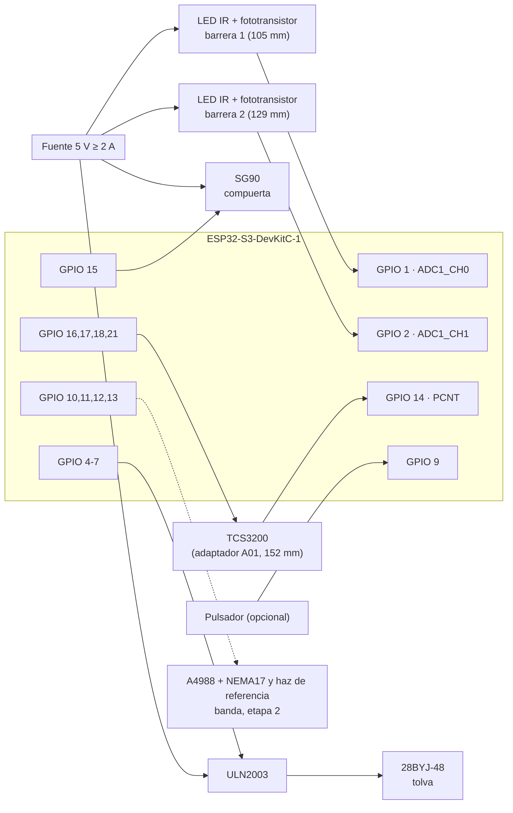

# Esquema de conexiones · etapa 1

Un ESP32-S3-DevKitC-1 controla toda la torre. Lista de conexiones (netlist) en
[`conexiones.csv`](conexiones.csv); el firmware usa exactamente estos pines
([`pines.h`](../../../firmware/etapa1_clasificador/include/pines.h)) y una prueba de CI
verifica que no se repiten ni caen en pines reservados del S3.





## Circuito de cada barrera

```
 5V ──[330 Ω]──►|── GND          LED IR 940 nm (≈ 11 mA), siempre encendido
                     ·  haz (ventana Ø1,6 en L01, a 10 mm sobre la repisa)
 3V3 ──C╲ fototransistor
         E──┬── GPIO 1 / 2 (ADC)
            └─[10 kΩ]── GND      haz libre: tensión alta · moneda: baja
```

## Alimentación

| Rama | Fuente | Consumo aprox. |
|---|---|---|
| ESP32-S3, TCS3200, fototransistores | USB (3V3 de la placa) | < 250 mA |
| 28BYJ-48 por ULN2003, paso completo | 5 V externos | ≈ 240 mA |
| SG90 | 5 V externos, 220 µF junto al servo | 150 mA, picos de 650 mA |
| 2 LED IR | 5 V externos | 22 mA |
| NEMA17 (etapa 2) | 12 V por el A4988 | según Vref |

GND de todas las fuentes unido al GND del ESP32.

## Driver de la banda (A4988)

| Pin del A4988 | Va a |
|---|---|
| STEP / DIR / EN | GPIO 10 / 11 / 12 (EN activo en bajo) |
| MS1, MS2, MS3 | 3V3 (1/16 de paso, 42,44 pasos/mm con el piñón v7) |
| RESET ↔ SLEEP | puenteados entre sí |
| VDD / GND lógico | 3V3 / GND del ESP32 |
| VMOT / GND motor | +12 V / GND, con 100 µF entre ambos junto al driver |
| 1A-1B, 2A-2B | un par de bobinas del NEMA17 cada uno (2 a 4 Ω dentro del par); si gira al revés, invertir 1A y 1B |
| Vref | ≈ 0,8 V con resistencia R100, ≈ 0,4 V con R050 |

El cero de la banda es la posición al encender: antes de dar energía, el vaso 9 va bajo el embudo.
Nunca conectar ni quitar el motor con 12 V aplicados.

## Al cablear

- Comprobar que el shield del ESP32-S3 deja libres todos estos pines.
- Unir primero las tierras y medir 5 V en el riel antes de conectar el ESP32
  (procedimiento completo en la [fase 4 de TODO.md](../../../TODO.md#fase-4--montaje-y-pruebas-físicas)).
