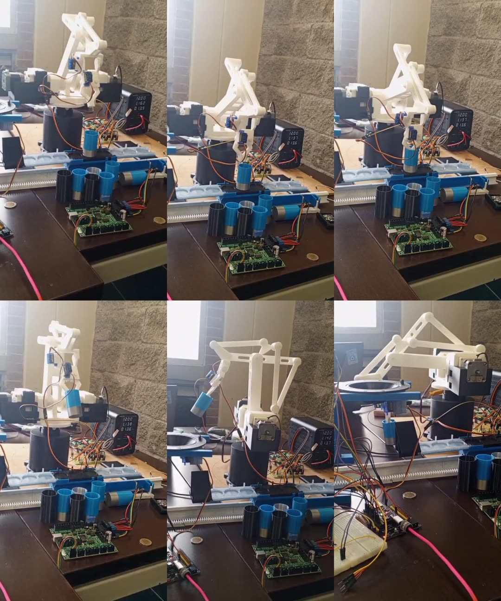

# Etapa 3 · Brazo de 4 GDL con garra

Brazo de doble paralelogramo (alcance ≈ 40 cm) diseñado en SolidWorks por Javier León y Samuel Rubio.
Tres NEMA 17 con reductora planetaria impresa 16:1 mueven la base (J1), el hombro (J2) y el codo (J3);
dos micro servos SG90 mueven el cabeceo de la muñeca (J4) y la pinza. El brazo tiene su propia ESP32
con dos drivers TB6560 y un TB6600 a 24 V (17,8 pasos por grado con 1/2 paso).

**Explicación completa** (mecánica, reductora, cálculos de par y de la pinza, electrónica, control,
cinemática y pruebas): [`docs/13-etapa3-brazo.md`](../../docs/13-etapa3-brazo.md).

| Carpeta | Contenido |
|---|---|
| [`brazo/`](brazo) | 25 STL (`stl/`), ensamble y actuadores en STEP (`step/`), [`GUIA_IMPRESION.md`](brazo/GUIA_IMPRESION.md), [`INFORME_CAD.md`](brazo/INFORME_CAD.md), scripts generadores |
| [`garra/`](garra) | Muñeca y pinza para SG90 (7 STL, SolidWorks nativo + STEP), [`GUIA_ENSAMBLE.md`](garra/GUIA_ENSAMBLE.md) |
| [`reductora/`](reductora) | Caja planetaria 16:1 de dos etapas (STL, STEP, generador paramétrico) |
| [`firmware/`](firmware) | Firmware de la ESP32 del brazo: interfaz web de calibración y prueba de motores ([`GUIA_CONEXIONES_Y_CALIBRACION.md`](firmware/ESP32_Calibracion_Robot4GDL/GUIA_CONEXIONES_Y_CALIBRACION.md)) |
| [`bom.csv`](bom.csv) | Lista de materiales del brazo |
| [`ENTREGA_ORIGINAL.md`](ENTREGA_ORIGINAL.md) | Índice del paquete CAD y firmware tal como se entregó |

Los archivos `12A`–`16` de `brazo/stl/` son la muñeca y pinza anteriores; la versión vigente es la de `garra/`.

## Orden de armado

1. Imprimir según [`GUIA_IMPRESION.md`](brazo/GUIA_IMPRESION.md) (pasadores al 100 % de relleno).
2. Armar las tres reductoras sobre los NEMA 17 (sol en el eje en D, 3 planetas por etapa, portaplanetas
   de salida con el eje de acero).
3. Base 010 con J1, engranaje 016 y plato 011; luego la torreta 04A con las cunas 04B y 04C.
4. J2 y J3 en sus cunas con las abrazaderas 05 (4 M4 cada una); brazo 004 y palanca 002 con el pasador Ø12.
5. Bielas, escuadra y antebrazo con los pasadores Ø8.
6. Muñeca y garra según [`GUIA_ENSAMBLE.md`](garra/GUIA_ENSAMBLE.md), con los SG90 centrados en 90° antes de atornillar las palas.

La versión anterior (brazo de 5 servos con PCA9685, usada en la simulación) quedó en
[`../archivo/etapa3-brazo-v1/`](../archivo/etapa3-brazo-v1).
